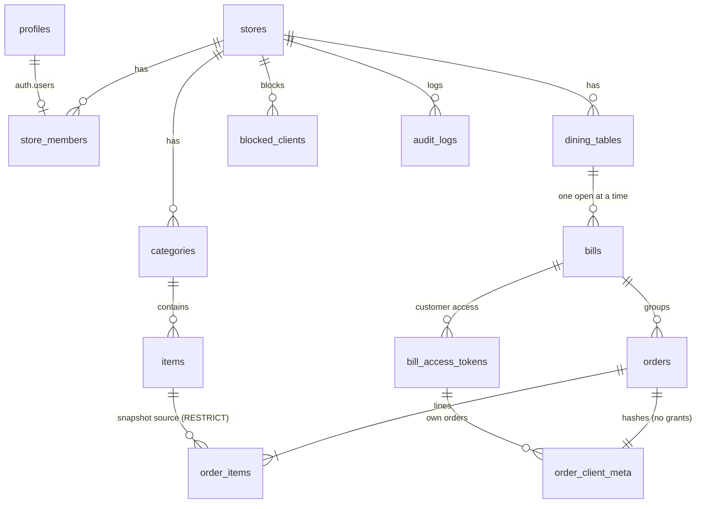

# 阶段 1 后端设计文档：多租户扫码点餐平台

> Next.js + Supabase 堂食点餐 MVP（F1–F12、F21）的数据库、权限、接口与防刷单设计。与 Page 同步：https://cursor.com/canvas/store-649cbae7-ec50-436b-99d9-04c875a3e9e8/c2a8ef76-eb5a-4fc7-b5fb-00d33c72c8d7

## 0. 版本、依据与文件

依据：需求文档 v0.4、前端设计 v0.3（更新 8 对照前端说明 v0.6）、项目经理与 Song Haw 已拍板的规则、安全审查报告（截至 2026-11-04；v6 安全修订逐条见 §17，v7 写入 Song Haw 关于验证与首单审核的决定；v8 按第二轮安全复查修订，逐条见 §18，需要前端配合的改动见 §19；更新 8 处理第二轮复查的复查（rereview-2）、回答前端说明 v0.6 的 16 问并逐处处理 9 处不一致、调整前后端分工，见 §21）。本页给 Cursor 云端编码代理直接照做：完整 SQL 以仓库文件为准，本页只摘录关键片段。

| 文件（仓库内路径） | 内容 |
| --- | --- |
| supabase/migrations/0001_init.sql | 默认权限收回、schema、7 个枚举、13 张表、索引、触发器、列级授权、RLS、bill_overview 视图、Storage 桶与策略、Realtime 发布与私有频道策略 |
| supabase/migrations/0002_rpc.sql | 16 个 RPC（4 个顾客端只给 customer_api，12 个店家/平台给 authenticated）+ 内部校验函数 + 授权白名单 + customer_api 角色 |
| supabase/tests/rls_rpc.test.mjs | 117 条验收断言（验证后才建店、首单审核字段锁定、隔离、函数与表权限、NULL 安全、令牌作用域与撤销、重置桌码、限流兜底、停用、幂等、状态机、金额、统计、Storage、Realtime），本地 PGlite 全部通过 |
| supabase/tests/supabase_stub.sql | 本地测试用的 auth / storage / realtime / 角色 / Supabase 平台默认权限桩 |
| supabase/migrations/0003_security_rereview.sql | 第二轮复查迁移（PR1b）：先验证后设密码（首次验证清空密码、profiles.password_set_at、pg_cron 每小时清理 24 小时未验证账号）、Before User Created Hook 号码白名单、customer_api 改为 LOGIN 角色、orders.device_seq_in_bill、按 IP 先要求 Turnstile 再拒绝、resolve_table for share、管理员要求 aal2、管理员账号不建店 |
| supabase/migrations/0004_frontend_alignment.sql | 更新 8 迁移（归入 PR1b）：H-1 stores 列级 select（店家读不到 status_reason，待安全顾问复查）、管理员审计行与 value_hash 对店家隐藏、M-3 自动确认也擦密码、L-1 首次验证删会话、is_profile_complete、拉黑列表与按 id 解除（写审计）、C2 预估合计、served_at 索引、删除令牌撤销原因 merchant、get_my_context（含 password_set_at）/ ensure_my_store、管理员 aal1 → MFA_REQUIRED、注册不收店名（L-5）（§21） |
| supabase/tests/frontend_alignment.test.mjs | 更新 8 的 88 条断言（前端问题、H-1、v0.6 的 password_set_at / MFA_REQUIRED / L-5 / 店家可读列清单），本地 PGlite 全部通过（§21） |
| supabase/tests/rereview.test.mjs + supabase_stub_rereview.sql | 第二轮复查的 64 条断言（叠加 0004 运行），本地 PGlite 全部通过；stub 补充 supabase_auth_admin 角色、auth.users 的密码与 app_metadata 列、auth.jwt() |
| supabase/tests/database/auth_roles.test.sql | pgTAP 25 条（rereview-3 低-6 补 value_hash 列权限、不能直接 delete 拉黑两条）：在 supabase start 环境以 supabase_auth_admin 身份写 auth.users，确认触发器、hook 权限、customer_api、pg_cron 任务（L-N7）；rereview-2 L-8 补充连接数与超时、purge 不删已验证账号、cron.job、status_reason 列权限 |
| supabase/tests/rereview2.test.mjs | 31 条断言：rereview-2 的 M-3、L-1、L-8（扫描 auth / extensions / private / public / realtime / storage 全部 schema 的权限）；rereview-3 中-1（按 GoTrue 的 INSERT → UPDATE app_metadata → Confirm 顺序模拟管理员建号：一步建号密码被擦、两步建号密码保留）、低-4（0005 清理边界） |
| supabase/migrations/0005_purge_resend_boundary.sql | rereview-3 低-4（归入 PR1b）：只重定义 private.purge_unverified_users()，按最后一次发确认（coalesce(confirmation_sent_at, created_at)）超过 24 小时且注册超过 25 小时才删，A8 重发的新链接不会被清理弄失效 |
| supabase/tests/runbook_suspend.test.mjs | 30 条：直接执行运维手册里标了 RUNBOOK 的 SQL（查店、停用、验证、恢复；rereview-3 低-3：文本含单引号、审计记 db_user / session_user） |
| docs/runbook-emergency-suspend-store.md | 管理员 TOTP 上线前，用 SQL Editor 紧急停用 / 恢复店铺（第 0–8 步） |
| docs/pr1b/rls_rpc.test.mjs.patch | 旧测试叠加 0003 / 0004 后的 5 处预期变化，PR1b 分支 git apply；打补丁后 117 条全过 |
| supabase/templates/*.html | 5 个邮件模板（confirmation、magic_link、recovery、email_change、reauthentication）：只放 token_hash 链接，不放数字验证码（M-N4）；next={{ .RedirectTo \| urlquery }}（L-3，§21） |
| .env.example | 环境变量示例（§1），不含 SUPABASE_JWT_SECRET |
| docs/launch-checklist-twilio.md | 上线前 Twilio 控制台设置清单（M-N1），一步一截图 |
| docs/backend-design.md | 本页的 Markdown 版 |
| docs/implementation-plan.md | PR1、PR1b、PR2–PR5 任务：顺序、依赖、范围、验收标准 |

> 仓库 Limsonghaw/restaurant-ordering 目前只有 README.md，没有 supabase/ 目录和环境变量命名，所以本文按 Next.js App Router 标准结构定路径（app/、lib/、supabase/），环境变量名见 §1。

## 1. 总体架构与职责划分

| 层 | 使用者 | 做什么 | 为什么 |
| --- | --- | --- | --- |
| Route Handler `app/api/**/route.ts` | 顾客；登录后设置密码（A6） | 验二维码签名、限流、拉黑、Turnstile，再用 customer_api 数据库登录角色（postgres.js 经 Supavisor 连接）调 customer_* RPC；A6 校验会话后改密码 | publishable key 是公开的，RLS 无法绑定二维码令牌；所以 anon 零权限；顾客流量不用 service_role，也不持有 JWT 密钥（§18 H-N2） |
| 浏览器直连 Supabase Auth（GoTrue） | 商家注册、登录、验证、找回密码 | signInWithOtp / verifyOtp / signInWithPassword / signOut，带 Turnstile captchaToken | GoTrue 按真实客户端 IP 限流，服务端不用持有 secret key（§18 M-N2、§19） |
| Supabase 直连（supabase-js + RLS） | 店家、平台管理员 | 读列表、简单增改（菜单、桌子、店铺资料、拉黑解除） | 少写服务端代码；RLS + 列级授权 + 触发器三层兜底 |
| RPC（Postgres 函数） | 店家状态变更、顾客下单 | 状态机、结账、批量排序、统计、下单 | 需要事务原子性和跨表校验 |
| Server Action | 店家 | 只有 `getTableQrLinks` | 签名需要 QR_SIGNING_SECRET，不能进浏览器 |
| Realtime postgres_changes（私有频道） | 只有店家 | 新订单、状态变化、账单变化推送 | 顾客端改用约 10 秒轮询（§11） |

| 环境变量 | 位置 | 用途 |
| --- | --- | --- |
| NEXT_PUBLIC_SUPABASE_URL | 浏览器+服务端 | Supabase 项目地址 |
| NEXT_PUBLIC_SUPABASE_PUBLISHABLE_KEY | 浏览器+服务端 | 店家端直连与认证（RLS 生效）；新版 publishable key（sb_publishable_…），取代 anon key |
| CUSTOMER_API_DATABASE_URL | 仅服务端 | customer_api 的 Postgres 连接串：Supavisor transaction 模式、6543 端口、用户名 customer_api.<project-ref>（§18 H-N2） |
| SUPABASE_SECRET_KEY | 不进 Vercel，只在运维本机临时使用 | 建平台管理员账号等运维脚本；应用代码禁止引用。SUPABASE_JWT_SECRET 已删除，ESLint / CI 禁止出现这个名字 |
| QR_SIGNING_SECRET | 仅服务端 | 桌台二维码 HMAC 签名（≥32 字节随机） |
| CLIENT_HASH_SECRET | 仅服务端 | 设备 ID / IP 按店做 HMAC（store_id:值）后再入库 |
| DEVICE_COOKIE_SECRET | 仅服务端 | 签发顾客设备 cookie did 的 HMAC 密钥 |
| UPSTASH_REDIS_REST_URL / UPSTASH_REDIS_REST_TOKEN | 仅服务端 | 限流 |
| TURNSTILE_SECRET_KEY / NEXT_PUBLIC_TURNSTILE_SITE_KEY | 服务端 / 浏览器 | 注册 / 登录 / 找回密码 / 重发验证码必用（Supabase Auth CAPTCHA，secret 填在 Supabase）；下单按需（Route Handler 校验） |
| NEXT_PUBLIC_SITE_URL | 浏览器+服务端 | 二维码链接、邮件回跳地址 |
| NEXT_PUBLIC_AUTH_SMS_ALLOWED_COUNTRIES | 浏览器 | 允许的国家 ISO 码，逗号分隔，默认 MY（L-N2）；只做前端提示，真正的白名单在 Before User Created Hook（M-N1） |
| TWILIO_ACCOUNT_SID / TWILIO_VERIFY_SERVICE_SID / TWILIO_AUTH_TOKEN | 只给 Supabase Auth（本地 config.toml 用 env() 引用，生产在 Dashboard 填） | 短信服务商（§20）；用 Verify 专用子账号，设置见 docs/launch-checklist-twilio.md；Next.js 不读取 |

| lib 模块 | 职责 |
| --- | --- |
| lib/supabase/server.ts | @supabase/ssr 的 cookie 会话客户端（Route Handler、Server Component） |
| lib/supabase/browser.ts | 浏览器客户端（店家端直连、Realtime） |
| scripts/ops/create-admin.ts | 运维脚本（本机运行，机密只从环境变量 SUPABASE_URL / SUPABASE_SECRET_KEY / ADMIN_EMAIL / ADMIN_PASSWORD 读）：建平台管理员账号，rereview-3 中-1 两步建号——① auth.admin.createUser 不带密码（email_confirm true，app_metadata = { no_store: true, provisioned_by: 'ops' }）→ ② auth.admin.updateUserById 设密码 → ③ signInWithPassword 自检，失败以非 0 退出；应用代码里没有 secret key 客户端 |
| lib/supabase/customer.ts | customer_api 客户端：postgres.js 连接（max 1、prepare false、ssl require），首行 `import 'server-only'`，只暴露 4 个 customer_* 封装；全仓库只有这个文件能 import 'postgres' |
| lib/client-context.ts | 可信 IP（x-vercel-forwarded-for / x-real-ip）、设备 cookie 签发与验签、按店 HMAC |
| lib/auth/safe-next.ts | 登录后跳转的 next 白名单，用 URL 解析（L-N4）；前端 PR-C 先建纯函数版，后端 PR2 接手填真实逻辑、签名不变（§21.4） |
| lib/auth/reauth.ts | A6 的 amr 检查：5 分钟内用验证码或邮件链接验证过（L-N6） |
| lib/auth/gotrue-errors.ts | GoTrue 错误码 → 本项目错误码与中文提示（§19） |
| lib/validation/phone.ts | libphonenumber-js/max：号码有效、类型为手机、ISO 国家白名单（L-N2） |
| lib/qr.ts | 二维码令牌签名与验签 |
| lib/ratelimit.ts | Upstash 限流器（各 scope 的阈值集中在这里） |
| lib/hash.ts | sha256、HMAC、请求体规范化哈希 |
| lib/api/schemas.ts | 全部 zod schema（§9） |
| lib/api/errors.ts | 错误码表、`toErrorResponse()`、PostgREST 错误映射 |

## 2. 角色模型

| 角色 | 如何识别 | 能做什么 |
| --- | --- | --- |
| 平台管理员 | `profiles.role = 'platform_admin'`（运维脚本建账号且不建店，再手工设置 role；调用管理员 RPC 必须是 aal2 会话，L-N1） | 看全部店铺列表与审计日志；启用/停用店铺。看不到各店订单与账单（已确认） |
| 店主 owner | `store_members.role = 'owner'` | 本店全部读写（店铺 active 时） |
| 店员 staff（预留） | `store_members.role = 'staff'` | MVP 不开放邀请，权限暂与 owner 相同 |
| 顾客（匿名） | 不登录；凭桌台二维码 + 设备 cookie + 账单令牌 cookie（均 HttpOnly） | 只能经 Route Handler：看本桌所属店的菜单、报价、下单、看本设备在这桌下的订单 |

MVP 一个账号只属于一家店（`store_members` 上 `unique(user_id)`）。邮箱或手机号任一验证通过时，由 auth.users 触发器一次性建 profile、店铺、owner 成员关系（见 §13 第 11 问、§9f）；未验证的账号没有店铺。第一次验证通过时触发器清空注册阶段可能被设的密码，用户必须在 /set-password 设密码后才能用密码登录（§18 H-N1）。Supabase 匿名登录已关闭，触发器对匿名用户也不建店。

## 3. 数据库表结构

共 13 张表（v6 新增 order_client_meta）+ 1 个视图 + 1 个 Storage 桶。所有业务表带 store_id；跨表外键用 (id, store_id) 复合外键，数据库层面保证不会串店；订单与账单另有 (bill_id, table_id) 复合外键保证同桌。



| 表 | 用途 | 主键 / 唯一 / 关键索引 |
| --- | --- | --- |
| stores | 店铺资料、营业开关、平台状态、费率 | pk id；unique slug |
| profiles | 平台角色（merchant / platform_admin） | pk user_id → auth.users |
| store_members | 账号与店铺关系 | pk (store_id, user_id)；unique user_id |
| dining_tables | 桌台 | unique (id, store_id)；unique (store_id, lower(label)) where 未删除 |
| categories | 菜品分类 | unique (id, store_id)；(store_id, sort_order) |
| items | 菜品 | 复合外键 (category_id, store_id) RESTRICT；(store_id, category_id, sort_order) |
| bills | 账单（一桌一张 open） | 部分唯一 `bills_one_open_per_table_uq(table_id) where status='open'`；unique (id, table_id)；(store_id, paid_at) where paid；(store_id, status, opened_at desc)；(store_id, updated_at) |
| orders | 订单（属于账单） | 复合外键 (bill_id, table_id)；unique (store_id, request_id)；unique (bill_id, seq_in_bill)；(store_id, updated_at)；(store_id, created_at)；(store_id, status) where new/accepted；device_seq_in_bill（设备序号，L-N3） |
| order_items | 订单明细（菜名、单价快照） | unique (order_id, line_no)；外键 item RESTRICT |
| bill_access_tokens | 顾客令牌（只存哈希；绑定设备；可撤销） | unique token_hash；(bill_id) |
| order_client_meta | 订单的幂等哈希、设备/IP 哈希、所属令牌（authenticated 无授权） | pk order_id；(store_id, ip_hash, created_at)；(store_id, device_hash, created_at)；(bill_token_id) |
| blocked_clients | 拉黑的设备 / IP（哈希） | unique (store_id, kind, value_hash) |
| audit_logs | 审计日志 | bigint identity；(store_id, created_at desc) |

### stores

| 字段 | 类型 | 约束 / 说明 |
| --- | --- | --- |
| id | uuid | pk |
| slug | text | unique；`^[a-z0-9][a-z0-9-]{2,39}$`；注册时随机 `s-xxxxxxxxxxxx` |
| name | text | 1–50 |
| logo_path | text | ≤300；CHECK 只允许 `{本店 id}/logo/{uuid}.webp\|jpg\|png` |
| address | text | ≤200，默认空 |
| opening_hours | text | ≤200，只做显示，不影响能否下单 |
| is_accepting_orders | boolean | 店家「营业中」开关，默认 true |
| status | store_status | 平台状态 active / suspended / pending_review（预留） |
| status_changed_at | timestamptz | 停用 / 恢复时间 |
| status_reason | text | ≤200，平台停用原因。H-1（待安全顾问复查）：留在 stores，但店家（authenticated）的列级 select 不含这一列，读它或 select('*') 报 42501；平台管理员经 admin_list_stores / admin_set_store_status（definer）读写。店家只看到「店铺已被平台停用，请联系平台」 |
| currency | char(3) | 固定 MYR |
| locale / timezone | text | zh-Hans / Asia/Kuala_Lumpur（预留 i18n） |
| service_charge_bp | integer | 0–2000 基点，默认 0，店家自设（已确认） |
| sst_bp | integer | 0–1000 基点，默认 0，店家自设；对小计+服务费征收 |
| cash_rounding | boolean | 5 仙进位：第一版不做，CHECK 固定 false（字段预留） |
| require_first_order_approval | boolean | 首单审核开关（H1，已定）：店家自己开关，默认 false。v1 只建字段：CHECK 锁定为 false、不授予 update，没有逻辑和界面；开启后的行为见 §12 |
| max_order_cents | integer | 单笔上限，默认 300000（RM3,000） |
| require_captcha | boolean | 强制 Turnstile |
| created_at / updated_at | timestamptz | updated_at 由触发器维护 |
| is_profile_complete | boolean 生成列 | 0004：address 与 opening_hours 去掉首尾空格后都非空为 true；店家不能写 |
| 列级 select（0004） | — | authenticated 只能 select 显式列出的列；以后新增的列默认店家读不到（待安全顾问复查） |

### dining_tables / categories / items

| 表.字段 | 类型 | 约束 / 说明 |
| --- | --- | --- |
| dining_tables.label | text | 1–20，店内（忽略大小写）唯一，可改名，二维码不变 |
| dining_tables.is_active | boolean | 停用后扫码报 TABLE_INVALID |
| dining_tables.qr_version | integer | 写进二维码签名（1–65535）；店家用 rotate_table_qr 重置：+1 作废旧码并撤销该桌令牌 |
| dining_tables.sort_order / deleted_at | integer / timestamptz | 软删除 |
| categories.name | text | 1–30 |
| categories.is_hidden / deleted_at | boolean / timestamptz | 见 §13 第 10 问 |
| items.name / description | text | 1–40 / ≤300 |
| items.price_cents | integer | 0–999999（仙） |
| items.image_path / thumb_path | text | CHECK 只允许 `{本店 id}/items/{uuid}[_thumb].webp\|jpg\|png` |
| items.is_sold_out / is_hidden / deleted_at |  | 三种状态语义不同，见 §13 第 10 问 |
| items.name_i18n / description_i18n | jsonb | 预留多语言，默认 {} |

### bills / orders / order_items

| 表.字段 | 类型 | 约束 / 说明 |
| --- | --- | --- |
| bills.status | bill_status | open / paid；「已付款」只存在于账单 |
| bills.subtotal_cents | integer | 未取消订单小计之和，由触发器 orders_sync_bill 维护 |
| bills.service_charge_bp/_cents, sst_bp/_cents, rounding_cents, total_cents | integer | open 时为 null（实时算）；付款时冻结快照；CHECK total = subtotal + sc + sst + rounding |
| bills.paid_at / paid_by | timestamptz / uuid | 索引 (store_id, paid_at) 供营业额统计 |
| orders.bill_id / seq_in_bill | uuid / integer | 所属账单；账单内「第 N 单」 |
| orders.device_seq_in_bill | smallint | 账单内第几台设备（1、2、3…）；同一设备沿用，新设备 +1；店家界面显示「设备 #n」，不暴露哈希（0003，L-N3） |
| orders.status | order_status | new → accepted → served；new/accepted 可取消；触发器强制只进不退 |
| orders.subtotal_cents / item_count | integer | 服务端计算；item_count 1–200 |
| orders.request_id | uuid | 幂等键（unique (store_id, request_id)）；请求体哈希、设备/IP 哈希移到 order_client_meta |
| orders (bill_id, table_id) | 复合外键 | orders_bill_table_fk → bills (id, table_id)：订单与账单必须同桌 |
| orders.cancel_reason / cancel_note | cancel_reason / text | 取消必须有原因；note ≤100，只在原因为 other 时保存 |
| orders.accepted_at / served_at / cancelled_at / updated_at | timestamptz | 触发器填写；updated_at 供 updated_since 补拉；0004 加索引 orders_store_served_idx (store_id, served_at desc) where status = 'served' |
| order_items.item_name / unit_price_cents | text / integer | 下单时快照；改菜名、改价不影响历史 |
| order_items.quantity / line_total_cents / note | integer / 生成列 / text | 1–99；单价×数量；≤50 |

### 其他表

| 表 | 字段要点 |
| --- | --- |
| profiles | user_id、role（merchant / platform_admin）、signup_channel（email / phone，首次验证通过的渠道）、password_set_at（验证后首次设密码的时间；为空时 middleware 跳 /set-password，0003） |
| store_members | store_id、user_id、role（owner / staff） |
| bill_access_tokens | bill_id、store_id、token_hash（sha256 hex）、device_hash（绑定签发设备）、scope（own_orders；'bill' 预留）、expires_at（签发 +12 小时）、revoked_at / revoked_reason（bill_paid / qr_rotated；0004 删除从未使用的 merchant）、last_used_at |
| order_client_meta | order_id、store_id、request_hash、device_hash / ip_hash（HMAC(secret, store_id:值)，30 天后置空）、bill_token_id；RLS 开启、无 policy、无 grant，不进 Realtime |
| blocked_clients | kind（device / ip）、value_hash、reason ≤100、source_order_id（复合外键，只能是本店订单）、created_by、expires_at（默认 +7 天）。0004：店家列级 select 不含 value_hash，不能直接 delete，列表与解除走 M14 / R13 |
| audit_logs | actor_type（user / admin / customer / system）、action、entity、entity_id、details jsonb。0004：店家只能读本店 actor_type ≠ 'admin' 的行，平台管理员读全部（待安全顾问复查） |
| 视图 bill_overview | security_invoker；open 账单按当前费率实时算金额，paid 取快照；附 is_estimate、order_count、unserved_count、table_label |

## 4. 枚举与状态机

| 枚举 | 取值 |
| --- | --- |
| store_status | pending_review（预留）、active、suspended |
| platform_role | merchant、platform_admin |
| member_role | owner、staff |
| order_status | new、accepted、served、cancelled |
| bill_status | open、paid |
| cancel_reason | sold_out（售完）、customer_request（顾客要求）、duplicate（重复下单）、other（其他，可填 cancel_note） |
| block_kind | device、ip |

| 订单状态变化 | 允许 | 由谁强制 |
| --- | --- | --- |
| new → accepted / cancelled | 是 | 触发器 `private.orders_guard` |
| accepted → served / cancelled | 是 | 同上 |
| served → 任何 | 否（INVALID_STATUS_TRANSITION） | 同上 |
| cancelled → 任何 | 否 | 同上 |
| 取消已付款账单里的订单 | 否（ORDER_BILL_CLOSED） | 同上 |
| 已付款账单的金额或状态 | 不可改（BILL_ALREADY_PAID） | 触发器 `private.bills_guard` |

已付款账单里未出餐的订单仍可继续推进到 served（前端规定可以先结账后出餐）。

## 5. 金额、费率与取整

| 项目 | 格式 | 理由 |
| --- | --- | --- |
| 金额 | integer，单位仙（sen），字段统一 `*_cents`；API 也传整数 | 无浮点误差；JS number 在此范围安全 |
| 费率 | integer 基点 bp：1000 = 10%，600 = 6%；API 字段 `*_bp` | 避免 0.1 这类小数；前端显示 bp/100 + % |
| 取整 | 四舍五入到仙（半数进位）：`div_round(n, d) = (2n + d) / (2d)`（整数除法） | 与一般收据习惯一致 |
| 服务费 | sc = round(subtotal × sc_bp / 10000) |  |
| SST | sst = round((subtotal + sc) × sst_bp / 10000) | 已确认：对「小计+服务费」征收；费率由店家自设 |
| 5 仙进位 | 第一版不做：stores.cash_rounding CHECK 固定 false，rounding_cents 恒为 0；算法保留在 calc_bill 里以后启用 | 已确认 |
| 账单金额 | open：按当前费率实时算（is_estimate=true）；paid：付款瞬间冻结快照 | 已拍板 |

| 算例（测试已覆盖） | 小计 | 服务费 10% | SST 6% | 取整 | 合计 |
| --- | --- | --- | --- | --- | --- |
| 例 1 | 4560 | 456 | 301（5016×6% = 300.96） | 0 | 5317 |
| 例 2 | 4620 | 462 | 305（5082×6% = 304.92） | 0 | 5387 |

营业额 = 当天（按 paid_at，马来西亚时间 UTC+8 切日）已付款账单 total_cents 之和，含服务费与 SST。已取消订单不计入账单小计。

## 6. 权限：授权与 RLS

- anon：零权限，并且在数据库层真正成立（§17 H2、M1）：0001 开头用全局 `alter default privileges … revoke execute on functions from public`，并撤销 public 新建表/序列对 anon、authenticated 的默认授权；0002 末尾把 public、private 全部函数收回后按白名单授权。顾客端一律经 Route Handler + customer_api 角色调 customer_* RPC。
- authenticated：只有 select + 列级 insert/update 授权；订单、账单、明细没有任何写权限，只能走 RPC。没有 delete 权限（拉黑解除除外），所以只能软删除。
- 辅助函数放在 `private` schema（SECURITY DEFINER，`set search_path = ''`），策略里用 `(select auth.uid())` 以便缓存；非 definer 函数同样 `set search_path = ''`（L3）。
- 店铺停用：BEFORE 触发器 `private.assert_store_writable` 对 stores / dining_tables / categories / items / blocked_clients 的写入报 STORE_SUSPENDED；RLS 的 `can_write_store()` 再兜底一次；店家 RPC 内部也检查。读取仍允许（已确认：停用后只读）。
- 平台管理员：能读 stores、profiles、store_members、audit_logs；看不到订单和账单（已确认）。private.is_platform_admin() 要求 JWT 的 aal = 'aal2'（已绑定 TOTP 并通过 MFA，0003，L-N1），否则管理员 RPC 报 FORBIDDEN、RLS 返回 0 行。
- bill_access_tokens、order_client_meta：RLS 开启、无 policy、无 grant，只有 definer 函数能读写。
- RLS 只 ENABLE 不 FORCE（§17 L1）：表 owner 不受 RLS 约束，这是 SECURITY DEFINER 函数能工作的前提；只有 definer 函数和 service_role 绕过 RLS，应用连接永远不用 owner 身份。

| 表 | select | insert | update | delete |
| --- | --- | --- | --- | --- |
| stores | 成员或平台管理员 | 仅触发器（注册） | 成员；列限 name/logo_path/address/opening_hours/is_accepting_orders/service_charge_bp/sst_bp；需 active | 无 |
| profiles / store_members | 本人或管理员 | 仅触发器 | 无 | 无 |
| dining_tables / categories / items | 成员 | 成员 + active（列级） | 成员 + active（列级） | 无（软删除走 RPC） |
| bills / orders / order_items | 成员 | 仅 RPC | 仅 RPC | 无 |
| bill_access_tokens / order_client_meta | 无 | 仅 RPC | 仅 RPC | 无 |
| blocked_clients | 成员 | 仅 RPC | 无 | 成员 + active |
| audit_logs | 成员（本店）或管理员 | 仅 RPC | 无 | 无 |
| realtime.messages（频道 store:{id}） | 本店成员 | 无（客户端不能发） | 无 | 无 |

```sql
create function private.is_store_member(p_store_id uuid) returns boolean
language sql stable security definer set search_path = '' as $$
  select exists (select 1 from public.store_members m
                 where m.store_id = p_store_id and m.user_id = (select auth.uid()));
$$;
create function private.can_write_store(p_store_id uuid) returns boolean ... -- 成员 且 stores.status = 'active'

create policy items_select on public.items for select to authenticated
  using (private.is_store_member(store_id));
create policy items_update on public.items for update to authenticated
  using (private.is_store_member(store_id)) with check (private.can_write_store(store_id));
grant update (category_id, name, description, price_cents, image_path, thumb_path,
              is_sold_out, is_hidden, sort_order) on public.items to authenticated;

-- 停用店铺给出明确错误码，而不是被 RLS 静默过滤成 0 行
create trigger items_writable before insert or update or delete on public.items
  for each row execute function private.assert_store_writable();
```

为什么顾客「只能看自己扫的那家店」：顾客没有任何表权限；Route Handler 先验 HMAC 签名拿到 store_id + table_id，再由 `customer_get_menu` 校验桌子属于该店、未停用、qr_version 一致、店铺 active，只返回这家店未隐藏、未删除的分类和菜品。下单同理，价格全部取数据库。

## 7. Storage

| 项目 | 设定 |
| --- | --- |
| 桶 | `menu-images`，public = true（菜单图片要给匿名顾客看），file_size_limit = 2097152（2 MB），allowed_mime_types = image/jpeg、image/png、image/webp |
| 路径 | `{store_id}/items/{uuid}.webp`、`{store_id}/items/{uuid}_thumb.webp`、`{store_id}/logo/{uuid}.webp` |
| 写权限 | storage.objects insert/update 策略：第一级目录必须是自己店的 store_id 且店铺 active；必须正好两级目录，第二级只能是 items 或 logo；文件名必须是 `{uuid}[_thumb].webp\|jpg\|jpeg\|png`（L5） |
| 前端压缩 | 上传前转 WebP（质量 0.8）：主图长边 ≤1200 px，缩略图 400×400 裁切，Logo 512×512 |
| 错误 | 超过 2 MB → FILE_TOO_LARGE（413）；类型不符 → UNSUPPORTED_FILE_TYPE（415），由前端把 Storage 错误映射过来 |
| 清理 | 改图后旧文件由前端删除（策略允许本店删除）；不做孤儿文件扫描（MVP） |
| 内容校验 | allowed_mime_types 只看声明的 Content-Type：前端上传前用 magic bytes 校验并重新编码为 WebP；图片响应加 `X-Content-Type-Options: nosniff`（L5） |
| 已知限制 | 桶为 public：店铺停用后图片仍可凭 URL 读取（菜单接口已不返回），业务上接受（L5） |

## 8. 接口总览（41 个）

C = 顾客 Route Handler（4）；A = 认证（8：7 个由浏览器直接调用 Supabase Auth，只有 A6 是 Route Handler，§19）；S = Server Action（1）；M = 店家直连 supabase-js（14）；R = 店家/平台 RPC（14）。另有 4 个只给 customer_api 的 RPC 由 C 类内部调用。「文件」列里 app/ 下的页面由前端 PR 实现；lib/data/supabase/、lib/auth/、lib/supabase/、app/api/ 由后端 PR 实现（更新 8，§21）。

| ID | 方法 + 路径 / RPC | 文件 | 鉴权 |
| --- | --- | --- | --- |
| C1 | GET /api/t/[code]/menu | app/api/t/[code]/menu/route.ts | 二维码签名 |
| C2 | POST /api/t/[code]/quote | app/api/t/[code]/quote/route.ts | 二维码签名 |
| C3 | POST /api/t/[code]/orders | app/api/t/[code]/orders/route.ts | 二维码签名 + 限流 + 可选 Turnstile |
| C4 | GET /api/t/[code]/bill | app/api/t/[code]/bill/route.ts | 二维码签名 + 设备 cookie + 账单令牌 cookie（可选） |
| A1 | 浏览器 supabase.auth.signInWithOtp（注册） | app/(auth)/register/page.tsx | 公开 + Turnstile + hook 号码白名单 + Supabase 按 IP 限流 |
| A2 | 浏览器 supabase.auth.signInWithPassword | app/(auth)/login/page.tsx | 公开 + Turnstile + Supabase 限流 |
| A3 | 浏览器 supabase.auth.signOut | components/auth/LogoutButton.tsx | 会话 |
| A4 | 浏览器 supabase.auth.signInWithOtp（忘记密码，与 A1 同一调用） | app/(auth)/forgot-password/page.tsx | 公开 + Turnstile |
| A5 | 页面 /auth/confirm（点「确认」后 verifyOtp token_hash） | app/auth/confirm/page.tsx | 邮件链接 token_hash |
| A6 | POST /api/auth/set-password | app/api/auth/set-password/route.ts | 会话 + 5 分钟内验证过（amr，L-N6） |
| A7 | 浏览器 supabase.auth.verifyOtp（短信验证码） | app/(auth)/verify/page.tsx | 公开 + Supabase /verify 按 IP 限流 |
| A8 | 重新发送（邮箱和手机号都适用）= 再调一次 A1 / A4 的 signInWithOtp | app/(auth)/verify/page.tsx 与邮件提示页 | 公开 + Turnstile |
| S1 | getTableQrLinks(tableIds) | app/store/tables/actions.ts | 店家会话 |
| M1 | rpc get_my_context（当前账号与店铺，0004） | lib/data/supabase/me.ts | 会话（只返回自己的） |
| M2 | 读店铺资料 | lib/data/supabase/store.ts | RLS |
| M3 | 改店铺资料（含营业中开关） | lib/data/supabase/store.ts | RLS + active |
| M4 | 分类与菜品列表 | lib/data/supabase/menu.ts | RLS |
| M5 | 新增 / 修改分类（含隐藏） | lib/data/supabase/menu.ts | RLS + active |
| M6 | 新增 / 修改菜品（含售完、隐藏） | lib/data/supabase/menu.ts | RLS + active |
| M7 | 桌子列表 / 新增 / 修改 | lib/data/supabase/tables.ts | RLS + active |
| M8 | 上传图片 | lib/data/supabase/images.ts | Storage 策略 |
| M9 | 进行中订单 + updated_since 补拉 | lib/data/supabase/orders.ts | RLS |
| M10 | Realtime 订阅 | lib/realtime/useStoreChannel.ts | RLS |
| M11 | 账单列表（筛选 + 分页） | lib/data/supabase/bills.ts | RLS |
| M12 | 账单详情 | lib/data/supabase/bills.ts | RLS |
| M13 | 订单记录（按日） | lib/data/supabase/orders.ts | RLS |
| M14 | rpc list_blocked_clients（拉黑列表，0004） | lib/data/supabase/blocks.ts | 成员（停用也可读） |
| R1 | rpc update_order_status | lib/data/supabase/orders.ts | 成员 + active |
| R2 | rpc mark_bill_paid | lib/data/supabase/bills.ts | 成员 + active |
| R3 | rpc reorder_categories | lib/data/supabase/menu.ts | 成员 + active |
| R4 | rpc reorder_items | lib/data/supabase/menu.ts | 成员 + active |
| R5 | rpc soft_delete_item | lib/data/supabase/menu.ts | 成员 + active |
| R6 | rpc delete_category | lib/data/supabase/menu.ts | 成员 + active |
| R7 | rpc soft_delete_table | lib/data/supabase/tables.ts | 成员 + active |
| R8 | rpc get_store_daily_stats | lib/data/supabase/stats.ts | 成员（停用也可读） |
| R9 | rpc block_client_from_order | lib/data/supabase/blocks.ts | 成员 + active |
| R10 | rpc admin_list_stores | lib/data/supabase/admin.ts | 平台管理员 |
| R11 | rpc admin_set_store_status | lib/data/supabase/admin.ts | 平台管理员 |
| R12 | rpc rotate_table_qr | lib/data/supabase/tables.ts | 成员 + active |
| R13 | rpc unblock_client（0004） | lib/data/supabase/blocks.ts | 成员 + active |
| R14 | rpc ensure_my_store（0004） | lib/data/supabase/me.ts | 已验证的会话 |

仅 customer_api：customer_get_menu、customer_quote、customer_place_order、customer_get_bill（anon、authenticated、service_role 都不能执行，已测试）。

## 9. 接口详情

所有 Route Handler 错误统一返回 `{"error":{"code","message","details"?}}`，message 是可直接显示的中文；RPC 错误用 `errcode P0001`，message 为错误码、detail 为 JSON，由 `lib/api/errors.ts` 转换。所有顾客端响应带 `Cache-Control: no-store`，Route Handler 声明 `export const dynamic = 'force-dynamic'`。店家 Cookie 会话的 POST（A6、Server Action）校验 Origin、只收 application/json。日志不记录令牌 cookie、备注、Turnstile token；RPC 的 detail 只透传 §10 列出的字段。

### 公共：二维码令牌、设备与哈希

| 项目 | 规则 |
| --- | --- |
| 二维码 URL | `{NEXT_PUBLIC_SITE_URL}/t/{code}`；前端 P1 路由 `/t/[code]` 与 API 的 `[code]` 相同 |
| code 格式 | `v1.` + base64url(store_id 16 字节 ‖ table_id 16 字节 ‖ qr_version uint16) + `.` + base64url(HMAC-SHA256(QR_SIGNING_SECRET, 前两段)[0..16])，约 72 字符 |
| 验签 | 常量时间比较；失败 → 404 TABLE_INVALID，并计入 IP 的「无效码」限流（20 次 / 10 分钟） |
| 设备 | 服务端签发 HttpOnly cookie `did`（Secure、SameSite=Strict、Path=/api/t、1 年）：`v1.{16 字节随机 base64url}.{HMAC(DEVICE_COOKIE_SECRET)}`；C1 首次访问时下发，验签失败当作没有；不再接受客户端自报的 X-Device-Id（M3） |
| IP | 只取 Vercel 平台写入的 `x-vercel-forwarded-for` / `x-real-ip`，不用 `x-forwarded-for` 第一段（M3） |
| 指纹哈希 | HMAC-SHA256(CLIENT_HASH_SECRET, store_id + ':' + 值)，每家店不同，不能跨店关联（L6） |
| request_hash | sha256(规范化 JSON：code 的 table_id + items 按原顺序的 item_id/quantity/unit_price_cents/note) |
| 账单令牌 | `crypto.randomBytes(32)`（CSPRNG）base64url；只把 sha256 hex 传给 RPC；放在 HttpOnly cookie `bt_{table_id 去横线}`（Secure、SameSite=Strict、Path=/api/t、Max-Age 12 小时），前端读不到也不用存（M4）；令牌绑定设备，作用域 own_orders：只看本设备在这桌下的订单（H1） |

```ts
// lib/api/schemas.ts（节选）
import { z } from "zod";
export const DeviceCookie = z.string().regex(/^v1[.][A-Za-z0-9_-]{22}[.][A-Za-z0-9_-]{22,43}$/); // 格式校验后再验 HMAC
export const CartLine = z.object({
  item_id: z.string().uuid(),
  quantity: z.number().int().min(1).max(99),
  unit_price_cents: z.number().int().min(0).max(999999), // 顾客看到的价格；以数据库为准
  note: z.string().trim().max(50).optional().default(""),
});
export const CartBody = z.object({ items: z.array(CartLine).min(1).max(30) })
  .refine(b => b.items.reduce((s, l) => s + l.quantity, 0) <= 200, { message: "总数量不能超过 200" });
export const PlaceOrderBody = CartBody.and(z.object({
  client_request_id: z.string().uuid(),
  turnstile_token: z.string().max(2048).optional(),
}));
export type ApiError = { error: { code: ErrorCode; message: string; details?: unknown } };
```

### C1 GET /api/t/[code]/menu

调用 `customer_get_menu(store_id, table_id, qr_version)`。店铺停用 → 403 STORE_SUSPENDED（不给菜单）；未营业仍返回菜单，`is_accepting_orders=false`。限流：IP 60 次/分钟。没有有效 `did` cookie 时在响应里下发设备 cookie。不带令牌只返回 `table_in_use` 布尔值（L7）。

```
200
{
  "store": { "id": "…", "name": "阿明茶餐室", "logo_path": "…/logo/…webp", "address": "…", "opening_hours": "每天 10:00–22:00",
             "is_accepting_orders": true, "currency": "MYR", "service_charge_bp": 1000, "sst_bp": 600 },
  "table": { "id": "…", "label": "A3" },
  "categories": [ { "id": "…", "name": "主食", "sort_order": 10 } ],
  "items": [ { "id": "…", "category_id": "…", "name": "炒饭", "description": "", "price_cents": 1250,
               "image_path": "…", "thumb_path": "…", "is_sold_out": false, "sort_order": 10 } ],
  "table_in_use": true
}
错误：TABLE_INVALID 404、STORE_SUSPENDED 403、RATE_LIMITED 429
```

### C2 POST /api/t/[code]/quote（只读报价）

请求体 = CartBody。调用 `customer_quote`，与下单共用 `private.validate_cart`（同样的校验和计价），但不写库、不报错，把问题放在返回里。超过金额或数量上限时 `limit_exceeded=true`、估算金额为 null（L4）。限流：设备 30 次/分钟。更新 8（0004）：新增预估合计，口径「只算这一单」（estimate_basis = 'this_order'）：本单小计按当前费率算服务费、SST、进位，不含同账单之前的单；界面写「本单预估，以结账金额为准」（§21 紧急第 5 项）。

```
200
{ "can_order": false, "is_accepting_orders": true, "limit_exceeded": false,
  "lines": [ { "line_no": 1, "item_id": "…", "item_name": "炒饭", "unit_price_cents": 1250, "quantity": 2, "line_total_cents": 2500, "note": "少辣" } ],
  "subtotal_cents": 2500, "item_count": 2,
  "estimate_basis": "this_order", "service_charge_bp": 1000, "sst_bp": 600,
  "estimated_service_charge_cents": 250, "estimated_sst_cents": 165, "estimated_rounding_cents": 0, "estimated_total_cents": 2915,
  "unavailable": [ { "item_id": "…", "reason": "sold_out", "name": "奶茶" } ],
  "price_changes": [ { "item_id": "…", "name": "炒饭", "client_unit_price_cents": 1200, "current_unit_price_cents": 1250 } ],
  "max_order_cents": 300000 }
错误：VALIDATION_FAILED 400、TABLE_INVALID 404、STORE_SUSPENDED 403、RATE_LIMITED 429
```

### C3 POST /api/t/[code]/orders（下单）

1. zod 校验 PlaceOrderBody；读取并验签设备 cookie（没有或无效 → 400 VALIDATION_FAILED，前端先调 C1 拿 cookie）。
2. 验二维码签名 → TABLE_INVALID。
3. Upstash 限流（设备 → RATE_LIMITED，带 Retry-After；桌级超 6 次/5 分钟 → 要求 Turnstile，硬拒绝由数据库 table_db 兜底；IP：10 分钟 20 单起要求 Turnstile，100 单才 429，M-N3；店，§12）；桌级超 6 次/5 分钟、IP 超 20 单、店级超阈值、require_captcha，或 Upstash 不可用（fail-closed）时要求 Turnstile：无 turnstile_token → CAPTCHA_REQUIRED，校验失败 → CAPTCHA_FAILED，通过则 p_captcha_verified=true。
4. 用 CSPRNG 生成新令牌明文 T，经 lib/supabase/customer.ts（postgres.js，customer_api 身份）调用 `customer_place_order(…, p_device_hash, p_ip_hash, p_bill_token_hash = sha256(cookie 里的旧令牌), p_new_bill_token_hash = sha256(T), p_captcha_verified)`；哈希必须是 64 位 hex（NULL → VALIDATION_FAILED）。
5. RPC 内：入参判空 → 锁桌子行、店铺行加 for share（L9）→ 店铺/桌子/营业检查 → 幂等（同 request_id 同内容返回原单 replayed=true，同一设备没收到令牌时重新下发；内容不同 IDEMPOTENCY_KEY_REUSED）→ require_captcha → 拉黑 → 数据库兜底限流（桌 / 设备；同店同 IP 10 分钟 ≥100 单 RATE_LIMITED，≥20 单且未过 Turnstile → CAPTCHA_REQUIRED，details.scope = 'ip_db'）→ validate_cart（ITEM_UNAVAILABLE / PRICE_CHANGED，整单拒绝）→ 上限 → 取或开 open 账单 → 沿用或签发本设备令牌（scope=own_orders）→ 写订单（含 device_seq_in_bill）、order_client_meta 与快照明细。
6. bill_token_issued=true 时用 Set-Cookie 写入 `bt_{table}`；响应体不含令牌。

```
请求
{ "client_request_id": "0b6f…", "items": [ { "item_id": "…", "quantity": 2, "unit_price_cents": 1250, "note": "少辣" } ] }

201（首次）/ 200（replayed=true）
Set-Cookie: bt_<table>=…; HttpOnly; Secure; SameSite=Strict; Path=/api/t; Max-Age=43200（仅 bill_token_issued=true）
{ "replayed": false, "bill_token_issued": true,
  "order": { "id": "…", "seq_in_bill": 1, "status": "new", "subtotal_cents": 2500, "item_count": 2, "created_at": "2026-11-04T10:15:00Z",
             "cancel_reason": null, "lines": [ { "item_name": "炒饭", "quantity": 2, "unit_price_cents": 1250, "line_total_cents": 2500, "note": "少辣" } ] },
  "bill": { "id": "…", "status": "open" } }   // 不返回整桌金额；本设备的金额看 C4

409 PRICE_CHANGED
{ "error": { "code": "PRICE_CHANGED", "message": "部分菜品价格已更新，请确认后重新下单",
  "details": { "items": [ { "item_id": "…", "name": "炒饭", "client_unit_price_cents": 1200, "current_unit_price_cents": 1250 } ] } } }
409 ITEM_UNAVAILABLE   details.items: [{ item_id, reason: "sold_out" | "unavailable", name? }]
其他：TABLE_INVALID 404、STORE_SUSPENDED 403、STORE_CLOSED 409、ORDER_LIMIT_EXCEEDED 422、IDEMPOTENCY_KEY_REUSED 409、
      DEVICE_BLOCKED 403、CAPTCHA_REQUIRED / CAPTCHA_FAILED 403、RATE_LIMITED 429
```

### C4 GET /api/t/[code]/bill（顾客进度轮询）

没有令牌 cookie：只返回 `table_in_use`（这桌有没有在用的账单，布尔值，L7），不返回内容。有令牌：令牌必须属于本店、本桌、本设备，未撤销、未过期；scope=own_orders 时只返回本设备在这张账单下的订单，金额是这些订单的估算（amounts_basis=own_orders），看不到同桌其他设备的订单（H1）。顾客能看到 cancel_reason，看不到 cancel_note。限流：令牌 12 次/分钟、IP 120 次/分钟。

```
200（进行中）
{ "view": "bill", "scope": "own_orders", "store": { "name": "…", "is_accepting_orders": true }, "table": { "label": "A3" },
  "bill": { "id": "…", "status": "open", "opened_at": "…", "paid_at": null, "currency": "MYR", "token_expires_at": "…", "amounts_basis": "own_orders",
            "subtotal_cents": 2500, "service_charge_cents": 250, "sst_cents": 165, "rounding_cents": 0, "total_cents": 2915, "is_estimate": true },
  "orders": [ { "id": "…", "seq_in_bill": 1, "status": "accepted", "subtotal_cents": 2500, "created_at": "…", "cancel_reason": null,
                "lines": [ { "item_name": "炒饭", "quantity": 2, "unit_price_cents": 1250, "line_total_cents": 2500, "note": "少辣" } ] } ],
  "poll_after_ms": 10000 }

410（结账即撤销令牌：前端显示「已结账，谢谢光临」并停止轮询，服务端 Set-Cookie 清除令牌）
{ "error": { "code": "BILL_TOKEN_EXPIRED", "message": "这张账单已结束", "details": { "reason": "bill_paid" } } }
details.reason：bill_paid（已结账，R2）| qr_rotated（店家重置了桌码，R12）| expired（签发满 12 小时）；更新 8 删除了从未使用的 merchant

200（无令牌）{ "view": "table", "table_in_use": true, "bill": null, "orders": [], "poll_after_ms": null }
401 BILL_TOKEN_INVALID（令牌不存在，或不属于本店 / 本桌 / 本设备）
```

### A1–A8 认证（浏览器直连 Supabase Auth；邮箱或手机号；先验证后设密码）

Song Haw 已定（含安全审查 M5）：商家用邮箱或手机号注册，用哪个就验证哪个，验证通过前没有店铺。v8 按第二轮复查改为：① 注册不收密码，验证通过后才设密码（H-N1）；② 认证请求由浏览器直接调用 Supabase Auth（GoTrue），Next.js 只保留 A6 一个 Route Handler（M-N2，比较见 §19）；③ 号码白名单由数据库的 Before User Created Hook 强制（M-N1），前端只做提示。号码统一为 E.164，只收马来西亚手机号。

| 接口 | 调用 | 成功 | 错误（GoTrue code → 本项目错误码） |
| --- | --- | --- | --- |
| A1 注册 | `signInWithOtp({ email } 或 { phone }, options: { shouldCreateUser: true, captchaToken, emailRedirectTo: SITE + '/store' })`（L-3：emailRedirectTo 写最终落点，不再拼 /auth/confirm，完整写法见 §21 紧急第 3 项）；表单只有邮箱或手机号，没有密码框，也不收店名（L-5，已定：登录后在店铺设置里填） | 邮箱：「如果这个邮箱可以使用，验证邮件已发出，请查收」；手机号：跳 /verify 输入验证码。新账号和已有账号都会真的收到邮件或短信（已有账号收到的是登录验证），返回完全相同（防枚举） | hook 拒绝 → PHONE_NOT_SUPPORTED；over_email_send_rate_limit / over_sms_send_rate_limit / over_request_rate_limit → RATE_LIMITED；captcha_failed → CAPTCHA_FAILED；sms_send_failed → SMS_SEND_FAILED；validation_failed → VALIDATION_FAILED |
| A2 登录 | `signInWithPassword({ email 或 phone, password, options: { captchaToken } })` | 会话写进 cookie（@supabase/ssr 浏览器客户端）→ /store | invalid_credentials → INVALID_CREDENTIALS（账号不存在、密码错误、还没设密码同一提示）；email_not_confirmed / phone_not_confirmed；over_request_rate_limit；captcha_failed |
| A3 退出 | `signOut()` | → /login |  |
| A4 忘记密码 | 与 A1 相同的 signInWithOtp（shouldCreateUser: true；emailRedirectTo: SITE + '/reset-password'；手机号存 sessionStorage 后跳 /verify?next=/reset-password）；不再用 resetPasswordForEmail | 同 A1 的提示。账号不存在时会建出一个未验证账号，24 小时后被清理任务删除（防枚举的代价）；如果对方点了链接，就会开通新账号和一个名为「我的餐厅」的空白店铺。页面文案见 §21 紧急第 6 项 | 同 A1 |
| A5 /auth/confirm | 页面读 token_hash、type、next（searchParams.get 得到的已是解码后的完整 URL），显示「确认」按钮；点击后 `verifyOtp({ token_hash, type })`，type 只接受 email / recovery / email_change（防止邮箱安全扫描器先打开链接把一次性令牌用掉） | 得到会话 → router.replace(safeNext(next))；password_set_at 为空时 middleware 改跳 /set-password?next=… | otp_expired 或令牌无效 → RESET_LINK_INVALID：显示「链接已失效」和「重新发送」（回 A1 / A4 表单，邮箱预填） |
| A6 POST /api/auth/set-password | `{ password }`（8–72，含字母和数字）；Cookie 会话。M-1：Origin 必须与 NEXT_PUBLIC_SITE_URL 完全相同（缺失也拒）、Sec-Fetch-Site 存在时必须是 same-origin，否则 403 FORBIDDEN；Content-Type 不以 application/json 开头 → 415 UNSUPPORTED_MEDIA_TYPE；响应 Cache-Control: no-store | 服务端 getClaims()：amr 里有 5 分钟内的验证码 / 邮件链接验证（lib/auth/reauth.ts）→ 用户自己的会话调用 `updateUser({ password })` → `signOut({ scope: 'others' })` → 200 `{ ok: true, next }`；触发器写 password_set_at | UNAUTHENTICATED 401；REAUTH_REQUIRED 401（验证超过 5 分钟，前端带用户重新收验证码）；weak_password → WEAK_PASSWORD；same_password → VALIDATION_FAILED；FORBIDDEN 403（Origin / Sec-Fetch-Site）；UNSUPPORTED_MEDIA_TYPE 415。M-2：持有 access token 的人可以直连 PUT /user 绕过本接口，真正的控制在 GoTrue（secure_password_change + 密码规则 8 位字母加数字）；A6 是统一入口，不是安全边界 |
| A7 短信验证码 | `verifyOtp({ phone, token, type: 'sms' })`，token 6 位数字 | 得到会话 → 同 A5 的跳转 | otp_expired / 验证码错误 → OTP_INVALID（统一提示）；over_request_rate_limit → RATE_LIMITED |
| A8 重新发送（邮箱和手机号都适用） | 再调一次 A1 / A4 的 signInWithOtp（同一个邮箱或号码，同样的 options），需要新的 Turnstile token；按钮倒计时 60 秒。不用 supabase.auth.resend({ type: 'signup' })，原因见 §21 不一致第 8 处（待安全顾问复查） | 同 A1 | 同 A1 |

```ts
// lib/validation/phone.ts（L-N2：用 ISO 国家码，不用区号前缀；只用字符类，不用反斜杠转义）
import { parsePhoneNumberFromString } from 'libphonenumber-js/max';
const allowed = new Set((process.env.NEXT_PUBLIC_AUTH_SMS_ALLOWED_COUNTRIES ?? 'MY').split(',').map(s => s.trim().toUpperCase()));
export function toE164(raw: string): string {
  const p = parsePhoneNumberFromString(raw, 'MY');
  if (!p || !p.isValid() || p.getType() !== 'MOBILE') throw new AppError('VALIDATION_FAILED');
  if (!p.country || !allowed.has(p.country)) throw new AppError('PHONE_NOT_SUPPORTED');
  return p.number;                                    // E.164，如 +60123456789
}
export const PhoneE164 = z.string().max(20).transform((v, ctx) => {
  try { return toE164(v); } catch (e) { ctx.addIssue({ code: 'custom', message: (e as AppError).code }); return z.NEVER; }
});
export const Password = z.string().min(8).max(72).regex(/[A-Za-z]/).regex(/[0-9]/);
// L-5（已定）：注册不收店名，登录后在店铺设置里填
export const AuthStartForm = z.union([
  z.object({ email: z.string().trim().toLowerCase().email().max(254) }),
  z.object({ phone: PhoneE164 }),
]);
export const SmsCode = z.string().regex(/^[0-9]{6}$/);
export const SetPasswordBody = z.object({ password: Password });

// lib/auth/safe-next.ts（L-N4：用 URL 解析比较 origin 和 pathname；L-3：next 是完整 URL 也能处理）
// v0.6 第 6 问：/admin 不进白名单，管理员登录后由 guard 带去 /admin 或 /admin/mfa
// 单元测试：'/' + 制表符 + '/evil.com'、'/%09/evil.com'、'//evil.com'、'https://evil.com'、'/storeevil' 都返回 '/store'
export function safeNext(next: string | null): string {
  try {
    const site = new URL(process.env.NEXT_PUBLIC_SITE_URL!);
    const u = new URL(next ?? '/store', site);
    const okPath = ['/reset-password', '/set-password', '/store'].includes(u.pathname) || u.pathname.startsWith('/store/');
    return u.origin === site.origin && okPath ? u.pathname + u.search : '/store';
  } catch { return '/store'; }
}

// lib/auth/reauth.ts（L-N6：A6 只接受 5 分钟内用验证码或邮件链接建立的会话）
const FRESH = new Set(['otp', 'magiclink', 'recovery', 'email/signup', 'sms/signup']);   // 实际 amr 取值上线前在真实项目确认
export function isFreshVerification(claims: { amr?: { method: string; timestamp: number }[] }): boolean {
  const now = Math.floor(Date.now() / 1000);
  return (claims.amr ?? []).some(a => FRESH.has(a.method) && now - a.timestamp <= 300);
}
```

Supabase Auth 设置（PR1b 修改 supabase/config.toml；生产项目只在 Dashboard 改，禁止对生产执行 supabase config push，L-N6）：`[auth] enable_anonymous_sign_ins = false, minimum_password_length = 8, password_requirements = 'letters_digits'`（M-2）；`site_url = env(NEXT_PUBLIC_SITE_URL)`；Redirect URLs（L-3）：本地 `http://localhost:3000/**`，Preview 项目 `https://*-<vercel-team>.vercel.app/**`，生产只填 `SITE/store`、`SITE/reset-password` 两个精确地址；`[auth.captcha] enabled = true, provider = 'turnstile'`；`[auth.email] enable_signup = true, enable_confirmations = true, otp_length = 8, otp_expiry = 900, secure_password_change = true, max_frequency = '1m'`（更新 8：同一邮箱两封邮件至少间隔 1 分钟）、`double_confirm_changes = true`（rereview-3 低-2，PR2：secure email change，改邮箱要新旧两个地址都确认；A5 接受 email_change 的前提）；`[auth.rate_limit] email_sent = 30`（全项目每小时，需要自定义 SMTP；内置邮件服务固定每小时 2 封，只用于开发；待安全顾问复查）；`[auth.email.template.confirmation / magic_link / recovery / email_change / reauthentication]` 的 content_path 指向 supabase/templates/*.html（只放 token_hash 链接，M-N4；next={{ .RedirectTo | urlquery }}，L-3）；`[auth.sms] enable_signup = true, enable_confirmations = true, max_frequency = '60s'`；`[auth.sms.twilio_verify] enabled = true`（env() 引用 TWILIO_*）；`[auth.rate_limit] sms_sent = 20, sign_in_sign_ups = 15, token_verifications = 15`；`[auth.hook.before_user_created] enabled = true, uri = 'pg-functions://postgres/private/hook_before_user_created'`；`[auth.sms.test_otp]` 只放在本地 / Preview 的配置里。短信验证码有效期是 Twilio Verify 固定的 10 分钟（控制台不能改，原文「5 分钟」作废）。开发和测试阶段先用 Supabase 自带发信；正式发信域名上线前跟平台名称一起定，再配自定义 SMTP（已确认）。

| 未验证用户与抢注在哪一层被拦 | 怎么拦 | 这一层失守时 |
| --- | --- | --- |
| ① Supabase Auth | 邮箱、手机号都开启 enable_confirmations：未验证账号用密码登录报 email_not_confirmed / phone_not_confirmed，拿不到会话 | 由第 ② 层兜底 |
| ② 数据库：建店 | handle_new_user 只在 email_confirmed_at 或 phone_confirmed_at 有值时建 profile + 店铺 + owner；未验证账号没有 store_members 行，RLS 返回 0 行，店家 RPC 报 NOT_FOUND / FORBIDDEN | 即使 Auth 被误设成自动确认，也只是「有会话、没店铺」 |
| ③ 数据库：抢注（H-N1） | 注册不收密码；第一次验证时触发器 auth_wipe_password_on_first_confirm 把 encrypted_password 清空，别人事先设的密码作废；验证后必须在 /set-password 设密码；24 小时仍未验证的账号由 pg_cron 每小时删除（purge_unverified_users） | PR2 E2E 覆盖：A 直连 GoTrue 用 X 和密码 P1 注册 → B 验证 X → 用 P1 登录失败 |
| ④ Next.js middleware（体验） | 更新 8：后端 lib/auth/guard.ts 的 getAuthState（调 M1 get_my_context）+ evaluateAccess 给出判断，前端 middleware.ts 按判断跳转：已登录但没有店铺 → /verify；有店铺但没设密码 → /set-password；平台管理员未完成两步验证 → /admin/mfa（§21） | 不承担安全责任 |

防枚举：A1 / A4 / A8 是同一个 signInWithOtp 调用，新旧账号都会真实发送、返回相同，所以响应内容和时间都对称（原 L-N5 的服务端固定延时在直连方案里不适用，见 §18）；A2 账号不存在、密码错误、还没设密码都是 invalid_credentials；A7 统一 OTP_INVALID。

| 防短信轰炸（SMS pumping） | 做法 |
| --- | --- |
| 号码白名单（数据库强制） | Before User Created Hook private.hook_before_user_created：新建用户带的手机号不是马来西亚手机号（去掉 + 后 601 开头，共 11–12 位）就返回 400 PHONE_NOT_SUPPORTED；直接拿 publishable key 调 GoTrue 也绕不过。前端 libphonenumber 只做提示（L-N2） |
| Twilio 侧 | Verify 专用子账号；Geo permissions 只开 Malaysia；Fraud Guard Max；同一号码 10 分钟最多 5 次（Twilio 内置）。步骤见 docs/launch-checklist-twilio.md |
| 发送频率（Supabase） | 同一号码 60 秒一条；全项目每小时 20 条（sms_sent）；每个 IP 每 5 分钟 15 次（sign_in_sign_ups） |
| 验证尝试 | 每个 IP 每 5 分钟 15 次（token_verifications）；Twilio 每个验证码最多校验 5 次；验证码 10 分钟过期 |
| 费用封顶 | 最坏情况 20 条/小时 × 24 小时 × $0.3889 ≈ $187/天；Twilio 关闭自动充值、余额只放 1–2 个月用量（硬上限），Usage Trigger 每天 $30 告警；PR5 监控 over_sms_send_rate_limit 次数 |
| 已知残余 | 已登录用户改手机号（phone_change）发的短信不经过 Before User Created Hook。v1 前端不提供改手机号 / 改邮箱的入口（M-4 决定）；但 API 仍然可以调用：持有会话的用户（或偷到会话的人）可以直接 `PUT /auth/v1/user {phone}` 或 `{email}`，靠 Twilio Geo 权限（只开 MY）、sms_sent、max_frequency 兜底，见上线前清单第 19 项；PR5 监控统计 user_updated 审计里 phone 字段的变化（rereview-3 低-1） |

### S1 与 M1–M14 店家直连

| ID | 调用 | 要点 / 错误 |
| --- | --- | --- |
| S1 | Server Action `getTableQrLinks(tableIds: string[])` → `{ table_id, label, url }[]` | 校验 tableIds 属于本店后签名；前端生成 A4 每页 4 个的 PDF |
| M1 | `rpc('get_my_context')` → `{ user_id, platform_role, aal, password_set, password_set_at, member_role, store: { id, slug, name, logo_path, status, status_changed_at, is_accepting_orders, is_profile_complete } \| null }`（0004）。不要再用 stores(*) | UNAUTHENTICATED（账号已删除但会话未过期 → signOut）；store 为 null → /verify 的「账号还没有完成设置」，可调 R14 ensure_my_store（§21 第 8 问）；响应示例见 §21 紧急第 2 项 |
| M2/M3 | `from('stores').select('id, slug, name, logo_path, address, opening_hours, is_accepting_orders, status, status_changed_at, service_charge_bp, sst_bp, max_order_cents, is_profile_complete')`（列级授权，必须写明列名；店家可读的 21 列、可改的 7 列见 §21 紧急第 1 项；读 status_reason 或 select('*') → 42501） / `.update({ name, logo_path, address, opening_hours, is_accepting_orders, service_charge_bp, sst_bp }).eq('id', id)` | STORE_SUSPENDED、VALIDATION_FAILED（23514） |
| M4 | categories、items 各 select，`.is('deleted_at', null).order('sort_order')` | is_hidden 的也返回给店家 |
| M5/M6 | insert / update 列级授权内字段 | STORE_SUSPENDED；23514 → VALIDATION_FAILED |
| M7 | dining_tables insert / update（label、is_active、sort_order）；重置二维码走 R12 rotate_table_qr | 23505 `dining_tables_store_label_uq` → TABLE_LABEL_TAKEN |
| M8 | `storage.from('menu-images').upload(path, blob, { contentType: 'image/webp', upsert: false })` | FILE_TOO_LARGE、UNSUPPORTED_FILE_TYPE |
| M9 | `from('orders').select('*, order_items(*), dining_tables(label)').in('status', ['new','accepted'])`；补拉 `.gt('updated_at', since)` | since = 上次最大 updated_at − 30 秒，按 id 去重 |
| M10 | `channel('store:'+id, { config: { private: true } }).on('postgres_changes', { schema:'public', table:'orders', filter:'store_id=eq.'+id }, …)`，bills 同理 | 见 §11 |
| M11 | `from('bill_overview').select('*', { count:'exact' })`，筛选 status、table_id、paid_at 区间；`.range(from, to)` 每页 20 | 日期区间用 `2026-11-04T00:00:00+08:00` 格式 |
| M12 | bill_overview 单条 + orders + order_items |  |
| M13 | orders 按 created_at 的马来西亚日区间；P5「已上菜」按 served_at 查，见 §21 第 3 问 |  |
| M14 | `rpc('list_blocked_clients', { p_include_expired: false })` → `[{ id, kind, reason, created_at, expires_at, is_active, source_order: { id, seq_in_bill, table_label, subtotal_cents, created_at } \| null }]`，最多 200 条，不含哈希；source_order 已带桌名和「第几单」，前端不用再查 orders（v0.6 第 10 问）；解除走 R13（不要直接 delete blocked_clients，0004 已收回 delete 权限） | FORBIDDEN（不是店铺成员）；停用的店也能看 |

### R1–R14 RPC

| RPC | 参数 | 返回 | 错误 |
| --- | --- | --- | --- |
| update_order_status | p_order_id, p_to, p_expected, p_cancel_reason?, p_cancel_note? | 订单行 | NOT_FOUND、STORE_SUSPENDED、ORDER_STATUS_CONFLICT（details.current_status）、INVALID_STATUS_TRANSITION、ORDER_BILL_CLOSED、VALIDATION_FAILED |
| mark_bill_paid | p_bill_id, p_expected_total_cents（店家确认时看到的合计） | 冻结后的账单金额 + tokens_revoked（结账即清台：撤销该账单全部顾客令牌） | BILL_TOTAL_CHANGED（details 为最新金额）、BILL_ALREADY_PAID、NOT_FOUND、STORE_SUSPENDED、VALIDATION_FAILED |
| reorder_categories | p_ids uuid[]（≤50） | void | VALIDATION_FAILED、NOT_FOUND、STORE_SUSPENDED |
| reorder_items | p_category_id, p_ids uuid[]（≤500） | void | 同上 |
| soft_delete_item | p_item_id | void | NOT_FOUND、STORE_SUSPENDED |
| delete_category | p_category_id | void | CATEGORY_NOT_EMPTY、NOT_FOUND |
| soft_delete_table | p_table_id | void | TABLE_HAS_OPEN_BILL、NOT_FOUND |
| get_store_daily_stats | p_date（马来西亚日期） | 见下 | FORBIDDEN |
| block_client_from_order | p_order_id, p_cancel=true, p_include_ip=false, p_days=7（1–30） | { blocked, cancelled, expires_at }；0004 起写审计 client.blocked（不含哈希） | NOT_FOUND、STORE_SUSPENDED、VALIDATION_FAILED |
| admin_list_stores | p_status?, p_limit=50（≤100）, p_offset | { total, stores[ owner_email, owner_phone（手机号注册的店主）, is_profile_complete, last_order_at … ] } | MFA_REQUIRED（管理员未完成两步验证）、FORBIDDEN（不是管理员） |
| admin_set_store_status | p_store_id, p_status, p_reason?（≤200） | { id, status, status_reason, status_changed_at }；原因留在 stores.status_reason，只有管理员经 definer 函数能读，店家没有这一列的列权限（H-1，待安全顾问复查） | MFA_REQUIRED、FORBIDDEN、NOT_FOUND、VALIDATION_FAILED |
| rotate_table_qr（R12） | p_table_id | { table_id, qr_version, tokens_revoked }；写审计 table.qr_rotated | NOT_FOUND、STORE_SUSPENDED、VALIDATION_FAILED |
| unblock_client（R13，0004） | p_block_id | { id, unblocked: true }；写审计 client.unblocked | VALIDATION_FAILED、NOT_FOUND（别家或已解除）、STORE_SUSPENDED |
| ensure_my_store（R14，0004） | 无 | { store_id, created }；已有店返回原店；平台管理员 / no_store 账号返回 { store_id: null, created: false, reason: 'no_store_account' }；新建时写审计 store.ensured；新店名一律「我的餐厅」（L-5） | UNAUTHENTICATED、FORBIDDEN（details.reason = 'not_verified'） |

```sql
get_store_daily_stats('2026-11-04') →
{ "date": "2026-11-04", "timezone": "Asia/Kuala_Lumpur", "currency": "MYR",
  "revenue_cents": 5387,
  "paid_bills": { "count": 1, "subtotal_cents": 4620, "service_charge_cents": 462, "sst_cents": 305, "rounding_cents": 0, "total_cents": 5387 },
  "open_bills": { "count": 2, "subtotal_cents": 3810, "total_cents": 4442 },
  "orders": { "count": 3, "cancelled_count": 1 } }
-- revenue = 当天 paid_at（UTC+8）的已付款账单 total；open_bills 按当前费率实时计算
-- 所有 RPC：必填参数为 NULL 一律 VALIDATION_FAILED（M2）
```

## 10. 错误码

| code | HTTP | 含义 |
| --- | --- | --- |
| VALIDATION_FAILED | 400 | 字段校验失败（details.field） |
| UNAUTHENTICATED | 401 | 未登录 |
| FORBIDDEN | 403 | 无权限（含 A6 的 Origin / Sec-Fetch-Site 校验失败，M-1） |
| MFA_REQUIRED | 403 | 平台管理员还没完成两步验证（aal1），前端带去 /admin/mfa；details.aal（更新 8，v0.6 第 16 问） |
| UNSUPPORTED_MEDIA_TYPE | 415 | A6 的 Content-Type 不是 application/json（M-1） |
| NOT_FOUND | 404 | 不存在或不属于本店 |
| CONFLICT | 409 | 其他唯一约束冲突 |
| RATE_LIMITED | 429 | 太频繁（Retry-After 头） |
| INTERNAL | 500 | 未知错误 |
| TABLE_INVALID | 404 | 二维码无效、桌子停用或删除 |
| STORE_SUSPENDED | 403 | 店铺被平台停用 |
| STORE_CLOSED | 409 | 店家暂停接单 |
| ITEM_UNAVAILABLE | 409 | 有菜品售完或下架（整单拒绝） |
| PRICE_CHANGED | 409 | 有菜品价格变化（整单拒绝） |
| ORDER_LIMIT_EXCEEDED | 422 | 超金额/数量/单账单 60 单上限 |
| IDEMPOTENCY_KEY_REUSED | 409 | 同一 request_id 内容不同（details 为空，不回传原订单 id） |
| CAPTCHA_REQUIRED | 403 | 需要人机验证（下单按需；注册 / 登录 / 找回密码始终需要） |
| CAPTCHA_FAILED | 403 | 人机验证失败 |
| DEVICE_BLOCKED | 403 | 设备或 IP 被店家拉黑 |
| BILL_TOKEN_INVALID | 401 | 账单令牌无效（不属于本店 / 本桌 / 本设备） |
| BILL_TOKEN_EXPIRED | 410 | 账单令牌过期或被撤销（details.reason：bill_paid / qr_rotated / expired） |
| INVALID_STATUS_TRANSITION | 409 | 不允许的状态变化 |
| ORDER_STATUS_CONFLICT | 409 | 状态已被别的设备改了 |
| ORDER_BILL_CLOSED | 409 | 账单已付款，不能取消订单 |
| BILL_ALREADY_PAID | 409 | 账单已付款 |
| BILL_TOTAL_CHANGED | 409 | 金额已变化，请重新确认 |
| CATEGORY_NOT_EMPTY | 409 | 分类下还有菜品 |
| TABLE_LABEL_TAKEN | 409 | 桌名重复 |
| TABLE_HAS_OPEN_BILL | 409 | 桌子有未结账单 |
| INVALID_CREDENTIALS | 401 | 账号或密码错误 |
| EMAIL_NOT_CONFIRMED | 403 | 邮箱未验证 |
| WEAK_PASSWORD | 400 | 密码太弱 |
| PHONE_NOT_CONFIRMED | 403 | 手机号未验证 |
| PHONE_NOT_SUPPORTED | 400 | 暂不支持这个国家或地区的手机号 |
| OTP_INVALID | 400 | 验证码错误或已过期 |
| RESET_LINK_INVALID | 400 | 邮件链接无效或过期 |
| REAUTH_REQUIRED | 401 | 设置密码前需在 5 分钟内重新验证（A6） |
| SMS_SEND_FAILED | 502 | 短信发送失败，请改用邮箱或稍后再试 |
| FILE_TOO_LARGE | 413 | 图片超过 2 MB |
| UNSUPPORTED_FILE_TYPE | 415 | 只支持 JPG / PNG / WebP |

认证类错误码由前端 lib/auth/gotrue-errors.ts 从 GoTrue 的 error code 映射（§19）。顾客 RPC 经 postgres.js 调用，错误映射与 PostgREST 相同；另外 57014（statement_timeout 3 秒）和连接失败 → INTERNAL 并告警，前端用同一 client_request_id 重试即可（幂等）。PostgREST 映射：P0001 → message 即错误码；42501 → FORBIDDEN；23505 → 按约束名映射（dining_tables_store_label_uq → TABLE_LABEL_TAKEN），否则 CONFLICT；23514 → VALIDATION_FAILED；其他 → INTERNAL。RPC 的 detail 只透传本表列出的字段，其余丢弃。

## 11. 实时推送与轮询

| 方案 | 优点 | 缺点 | 结论 |
| --- | --- | --- | --- |
| postgres_changes | 零额外代码；RLS 自动授权；表变化即推送 | 每个订阅者每条变更都做一次 RLS 检查，大规模时有瓶颈 | MVP 采用（店家端） |
| Broadcast（数据库触发器 realtime.send） | 扩展性好；可自定义负载 | 要写触发器；私有频道授权策略已就位（M8） | 店铺数 > 几百或单店多设备时再切换 |

- 店家端订阅 orders、bills（filter store_id）。断线重连、页面从后台回到前台、每 60 秒兜底，各做一次 updated_since 补拉（上次最大 updated_at − 30 秒，按 id 去重）。频道为私有频道 `{ config: { private: true } }`，Dashboard 关闭公开访问；realtime.messages 只允许本店成员加入，客户端不能发 Broadcast（M8）。
- 提示音：只要存在 status=new 的订单，每 10 秒响一次，所有登录设备都响；接单后停止。浏览器需要用户先点一次「开启声音」。
- 顾客端不用 Realtime，改为约 10 秒轮询 C4：顾客没有登录身份，Realtime 的 RLS 无法授权给匿名令牌；轮询可以走同一套限流和 no-store；页面进入后台（visibilitychange hidden）停止，回到前台立即拉一次；收到 410（结账、重置桌码、过期）时停止轮询并提示，令牌 cookie 由服务端清除。

## 12. 防刷单

| 措施 | 做法 | 防的风险 |
| --- | --- | --- |
| 签名二维码 + 可重置 | HMAC 令牌含 store_id、table_id、qr_version；验签失败计入无效码限流；码外流时店家用 rotate_table_qr 重置（旧码失效、该桌令牌撤销） | 猜 ID 下单、枚举别家店、桌贴照片外流 |
| 桌子与店铺检查 | RPC 内：桌子存在、启用、未删除、版本一致；店铺 active；is_accepting_orders | 停用的桌、关店后下单 |
| 限流（Upstash） | 见下表；数据库再兜底：同桌 / 同店同设备 10 分钟分别 ≤10 / 10 单；同店同 IP 10 分钟 ≥20 单要求 Turnstile、≥100 单拒绝（M-N3，避免误伤共用店内 Wi-Fi 或 CGNAT 的顾客）；单账单 ≤60 单；设备、IP 哈希必须非空 | 脚本刷单、Redis 故障时失守 |
| 幂等键 | client_request_id 唯一；同内容返回原单，不同内容报错 | 网络重试、连点造成重复单 |
| 数量与金额上限 | ≤30 行、每行 ≤99、总数 ≤200、金额 ≤ max_order_cents（默认 RM3,000） | 恶作剧大单 |
| 服务端定价 | 价格只取数据库；顾客价格只用于发现变化 | 篡改价格 |
| 可信标识 | IP 只取 Vercel 可信头；设备 ID 由服务端签发 HttpOnly 签名 cookie；哈希按店 HMAC | 伪造 X-Device-Id / XFF 绕过限流与拉黑；跨店关联顾客 |
| 令牌最小作用域 | 账单令牌绑定设备、只看本设备的订单；结账、重置桌码立即撤销 | 远程偷看同桌消费、跨批次泄露 |
| Turnstile | 下单：store.require_captcha、同桌 5 分钟超 6 次、同店同 IP 10 分钟超 20 单、店级 10 分钟超 120 单（自动 30 分钟）、Upstash 不可用（fail-closed）时要求，RPC 用 p_captcha_verified 再校验；注册 / 登录 / 找回密码 / 重发验证码始终要求（Supabase Auth CAPTCHA） | 大规模自动化、Redis 故障时失守、撞库 |
| 一键拒单 + 拉黑 | block_client_from_order：取消订单（原因 other）+ 拉黑设备（可选 IP），默认 7 天 | 同一部手机反复捣乱 |
| 异常监控 | audit_logs + Vercel 日志：429 次数、无效码次数、被取消率 >50% 的设备，每日汇总给平台管理员（PR5） | 及早发现攻击 |

| scope | 阈值（滑动窗口） |
| --- | --- |
| 下单 / 设备 | 3 次/分钟，20 次/小时 |
| 下单 / 桌 | 超 6 次/5 分钟要求 Turnstile；验证通过可继续，硬拒绝由数据库 table_db 兜底 |
| 下单 / IP | 20 次/10 分钟起要求 Turnstile；100 次/10 分钟 → 429（M-N3） |
| 下单 / 店 | 120 次/10 分钟 → 触发 Turnstile |
| 报价 / 设备 | 30 次/分钟 |
| 菜单 / IP | 60 次/分钟 |
| 账单轮询 | 令牌 12 次/分钟；IP 120 次/分钟 |
| 无效二维码 / IP | 20 次/10 分钟 |
| 商家认证（浏览器直连，Supabase 按客户端 IP 计，不用 Upstash） | 注册 / 发验证码 / 找回密码（sign_in_sign_ups）15 次/5 分钟；验证码校验（token_verifications）15 次/5 分钟；同一邮箱或号码 60 秒一条；登录走 Supabase /token 默认限额 |
| 短信（Supabase + Twilio） | 全项目 20 条/小时（sms_sent）；Twilio 同号 10 分钟最多 5 次；Geo permissions 只开马来西亚；关闭自动充值作为费用硬上限（docs/launch-checklist-twilio.md） |

| 限流存储 | 优点 | 缺点 |
| --- | --- | --- |
| Upstash Redis（推荐） | @upstash/ratelimit 现成滑动窗口；Vercel 无状态函数友好；选 ap-southeast-1 与 Vercel sin1 同区，延迟约 1–3 ms | 多一个服务（免费额度够 MVP） |
| Postgres 计数表 | 不加服务 | 每次请求写库、行锁竞争；攻击时把压力打到主库 |

> 已知限制：清掉 cookie 就能拿到新的设备 ID，所以按设备的限流和拉黑只挡普通用户，真正的兜底是按 IP 的限流、Turnstile 和数据库兜底。拿到桌码照片的人仍可在店外下单进入在座顾客的账单（受上述限流约束，但看不到别人的订单）；首单审核已定为店家开关，v1 只建字段（stores.require_first_order_approval，默认关），加入码不做。

> 首单审核开启后的行为（v1 不实现，只留字段）：该桌没有 open 账单时的第一单（新桌会话），以及已有 open 账单时新设备的第一单，进入「待审核」，不出厨、不计入账单；店家在进行中订单页确认后转为 new，拒绝则取消（原因 other），顾客端显示「等待店家确认」。实现时需要：删除 stores_first_order_approval_v1_ck、给该列加店家 update 授权、order_status 增加 pending_approval、状态机和账单小计排除待审核单、新增店家确认 RPC 与界面。

## 13. 回答前端的问题

| # | 问题 | 答复（已落到 SQL / 接口） |
| --- | --- | --- |
| 1 | 售完或改价怎么处理 | 整单拒绝：ITEM_UNAVAILABLE（details.items 列出 item_id、reason、name）或 PRICE_CHANGED（列出新旧单价）。请求带顾客看到的 unit_price_cents，以数据库为准。可先调 C2 报价预检 |
| 2 | 限流具体数字 | 见 §12 表；429 带 Retry-After 秒数 |
| 3 | 字段长度 | 店名 1–50；地址 ≤200；营业时间 ≤200；分类 1–30；菜名 1–40；描述 ≤300；价格 0–999999 仙；桌名 1–20；每单 1–30 行；每行 1–99；总数 ≤200；备注 ≤50；取消说明 ≤100；密码 8–72 含字母和数字；邮件验证码 8 位、短信验证码 6 位；邮箱 ≤254；设备 ID 由服务端签发（cookie）。数据库 CHECK 与 zod 一致 |
| 4 | 订单明细快照 | 同意：order_items 存 item_name、unit_price_cents |
| 5 | 图片规格 | JPG/PNG/WebP，≤2 MB（桶 file_size_limit + allowed_mime_types）；前端转 WebP，主图长边 ≤1200，缩略图 400×400，Logo 512×512 |
| 6 | 营业时间 | opening_hours 是纯文本，只显示；能否下单只看 is_accepting_orders 与 status |
| 7 | 日期边界 | 数据库存 timestamptz（UTC）；统计和「今天」按 Asia/Kuala_Lumpur（UTC+8）切日；API 时间一律 ISO 8601 |
| 8 | 轮询安全与已付款返回 | 令牌不可猜（CSPRNG）、只存哈希、HttpOnly cookie、绑定设备、只看本设备订单、限流、no-store、后台停止；结账即撤销，轮询收到 410（reason=bill_paid）后显示「已结账」并停止（v6 按安全审查修改，原「付款后只读 2 小时」取消） |
| 9 | 营业开关与平台状态分开 | 同意：is_accepting_orders（店家）与 status（平台）两个字段 |
| 10 | is_hidden、deleted_at、is_sold_out 区别 | is_hidden：顾客看不到，店家列表照常显示可编辑，可随时取消。deleted_at：软删除，顾客和店家默认列表都看不到，历史订单仍引用（外键 RESTRICT），不可恢复（MVP）。is_sold_out：顾客能看到但灰显不可点，下单报 ITEM_UNAVAILABLE。分类隐藏或删除时其菜品对顾客一并不可见 |
| 11 | 店铺记录什么时候建 | auth.users 触发器 handle_new_user：插入时（已验证的场景），或 email_confirmed_at / phone_confirmed_at 从空变为有值时，在同一事务里建 profile + store + owner；幂等（已建过就跳过），匿名用户不建。Song Haw 已定（M5）：先验证后建店，未验证账号没有店铺，分层拦截见 §9f。不需要前端在首次登录调 RPC 再处理重复。v8：注册不收密码，首次验证时清空注册阶段可能被设的密码，验证后在 /set-password 设密码；24 小时未验证的账号由 pg_cron 删除（§18 H-N1）。 |
| 12 | 停用后的后端拦截 | 已决定拒写：BEFORE 触发器报 STORE_SUSPENDED（403），RLS can_write_store 兜底，店家 RPC 同样检查；顾客端菜单/下单/报价都报 STORE_SUSPENDED。读取允许（已确认：停用后只读） |
| 13 | 账单快照 | 采纳：付款前实时算（is_estimate=true），mark_bill_paid 冻结费率与金额；店家确认时传入看到的合计，不一致报 BILL_TOTAL_CHANGED |
| 14 | 费率与金额格式、取整 | 金额整数仙；费率整数基点（1000 = 10%），店家自设；四舍五入到仙；5 仙进位第一版不做；见 §5 算例 |
| 15 | 只读报价接口 | C2 POST /api/t/[code]/quote，与下单共用 private.validate_cart |

字段名对齐：前端用 `client_request_id` 作为请求字段（数据库列名 request_id）；前端的 sold_out 状态对应 details.items[].reason = "sold_out"。

## 14. 待项目经理确认的问题

仍待确认（1 条，本次新产生）：

1. 短信服务商选型：推荐 Twilio Verify（理由和价格见 §20）。未回复前 PR2 按 Twilio Verify 接入；换服务商只改 Supabase Auth 设置和环境变量，不改代码。请 Song Haw 确认。

已拍板，从清单移除（原编号）：

| 原 # | 决定 | 落实位置 |
| --- | --- | --- |
| 1 | Song Haw：服务费和 SST 由店家自己设；SST 按「小计+服务费」算；第一版不做 5 仙进位 | stores 列级授权加 service_charge_bp / sst_bp；cash_rounding CHECK 固定 false；§5 算例与测试改为不进位 |
| 2 | Song Haw：注册不审核，注册即 active | stores.status 默认 active（pending_review 保留不用） |
| 3 | Song Haw：停用后只读 | 触发器 + RLS + RPC 拒写，读取允许 |
| 4（含 M5） | 注册不收店名（更新 8，L-5），建店一律「我的餐厅」，登录后在店铺设置里改；Song Haw：用邮箱或手机号注册（至少一项），用哪个验证哪个，验证通过后才建店；手机号用 Supabase Phone Auth 短信验证码，只收 +60（可配置白名单），加防枚举与防短信轰炸 | handle_new_user、profiles.signup_channel、§9f、§12、§20 |
| 5 | 项目经理：保留防枚举，邮箱已注册也返回相同提示；前端提示文字跟着改 | §9f A1 |
| 6 | 按默认值，但根据安全审查 L7 收紧：不带令牌只返回「这桌有没有在用」布尔值，不再返回单数 | customer_get_menu / customer_get_bill 的 table_in_use |
| 7 | 按安全审查 H1 / M4 改：结账即撤销令牌（不再保留 2 小时只读），顾客端收到 410 reason=bill_paid 显示「已结账」 | mark_bill_paid；§9e |
| 8 | 按默认值：有未结账单的桌子不能删除，可以停用 | soft_delete_table |
| 9 | 项目经理：同意单笔上限 RM3,000、30 行、每行 99 份（总数 200 按默认值） | max_order_cents、validate_cart、assert_cart_ok |
| 10 | 按默认值：§12 限流数字先上线，试营业后再调 | lib/ratelimit.ts |
| 11 | 按默认值：下单的 Turnstile 默认关闭、店级异常时自动开启；另按安全审查，注册 / 登录 / 找回密码始终开启，Upstash 故障时下单也要求 | §12 |
| 12 | 按默认值：一键拉黑默认 7 天（1–30 天） | block_client_from_order |
| 13 | 按默认值：顾客看得到取消原因，看不到取消说明 | customer_order_json |
| 14 | 项目经理：同意平台管理员看不到各店订单与账单内容 | RLS；测试已覆盖 |
| 15 | 按默认值：金额为 0 的账单允许直接标记已付款以关闭 | mark_bill_paid |
| 16 | 按默认值：过期或撤销的令牌 7 天后清除、审计日志保留 180 天；另按安全审查 L6，设备 / IP 哈希 30 天后置空 | private.purge_expired（pg_cron 每天） |
| 17 | 项目经理：开发和测试阶段先用 Supabase 自带发信；正式发信域名上线前跟平台名称一起定 | §9f |
| H1 远程下单防护 | Song Haw：第一版不开首单审核，做成店家开关、默认关；v1 只建字段 stores.require_first_order_approval，不做逻辑和界面；加入码不做 | 0001 stores；§12 写明开启后的行为 |

## 15. 实现顺序（详见 docs/implementation-plan.md）

| PR | 范围 | 开工条件（依赖） |
| --- | --- | --- |
| PR1 数据库 | 0001、0002 迁移（v7，含安全审查修订与验证后建店）；测试脚本（117 条）+ pgTAP；config.toml（Auth CAPTCHA、关闭匿名登录、邮箱与手机验证、Twilio Verify、短信频率与测试号码）；类型生成 `supabase gen types` | 无 |
| PR1b 安全复查迁移（v8 新增） | 0003 迁移；0004（更新 8：H-1、M-3、L-1、L-8、前端问题、MFA_REQUIRED、L-5）；测试 rereview 64、rereview2 19、frontend_alignment 88、runbook_suspend 27 + stub；pgTAP auth_roles 23；config.toml 的 Auth 段改为 v8（注册不收密码、hook、8 位 15 分钟邮件码、5 个邮件模板、限流数字、Secure password change、密码规则、Redirect URLs）；旧测试 5 处预期以补丁提供；psql 的 password 命令设置 customer_api 密码；运维手册；Twilio 与 Supabase Dashboard 设置截图（docs/launch-checklist-twilio.md） | 开工：PR1 合并 |
| PR2 认证与店家后台基础 | 认证封装（浏览器直连 Supabase Auth 的 A1–A5、A7、A8 的错误映射；A6 set-password Route Handler；lib/auth/guard.ts 判定，前端 middleware 负责跳转；safeNext、gotrue-errors、phone 校验；§19、§21）、M1–M8、R3–R7、R12、R13、R14、lib/api/errors.ts、lib/data/supabase/ 的店家数据层（页面全部在前端 PR） | 开工：PR1b 合并 + 前端 PR-A 合并（lib/data/types.ts）+ 前端 PR-C 合并（guard / safe-next 纯函数版）+ M-1 / M-2 / L-3 / L-7 写进文档（已完成） |
| PR3 顾客点餐 | lib/qr.ts、lib/ratelimit.ts（IP 两档，M-N3）、lib/client-context.ts、lib/supabase/customer.ts（postgres.js + CUSTOMER_API_DATABASE_URL）、C1–C4、S1（二维码链接）；L-9（customer_* 函数级 statement_timeout、连接参数固定超时）；L-11 书面接受 | 开工：PR1b 合并 + 前端 PR-A 合并（与 PR2 可并行） |
| PR4 店家实时订单与结账 | M9–M12、R1、R2、Realtime 私有频道、提示音、补拉；订单卡显示「设备 #n」 | 开工：PR2、PR3 合并 |
| PR5 记录、统计、平台与防刷收尾 | M13、M14、R8–R11、Turnstile、监控汇总；管理员 aal2 联调（/admin/mfa 页面在前端）、create-admin.ts；CI 检查生产无测试号码；短信异常告警 | 开工：PR4 合并；上线前验收（M-4、23 项真实环境确认）在 PR5 与前端全部页面合并后 |

## 16. 本次与历次更新改动

1. 更新 1：一桌一张 open 账单（部分唯一索引 + 下单 RPC 自动开单、锁桌子行处理并发）；orders.bill_id；「已付款」只在账单；未营业可看菜单不可下单、停用店铺全不可见；request_id 幂等；新增账单列表、店铺资料、批量排序、updated_since、找回密码；顾客端改为 10 秒轮询。
2. 更新 2：回答前端 9 问；状态只进不退（触发器）；cancel_reason 枚举 + cancel_note；软删除 + RESTRICT；为注册审核、停用后权限、服务费与 SST 预留字段。
3. 更新 3：营业额改为当天 paid_at（UTC+8）已付款账单 total 合计；bills.paid_at 索引；统计接口返回 open 账单实时金额与当日 subtotal / 服务费 / SST 合计。
4. 更新 4：回答前端 v0.3 的 6 问（§13 第 10–15 条）；店铺由注册触发器创建；停用拒写（触发器 + RLS + RPC，STORE_SUSPENDED）；付款冻结快照；费率基点与取整规则；新增只读报价接口 C2；核对 GitHub 仓库（仅 README）。
5. 更新 5：交付可执行 SQL（0001_init.sql + 0002_rpc.sql）并在本地 PGlite 跑通 40 条验收断言；每个接口给出文件路径、zod / TS 类型与错误码；新增 implementation-plan.md（5 个 PR）。
6. 更新 6：按安全审查报告修订，逐条见 §17。内容包括：函数与表的默认权限真正收回；customer_api 最小权限角色；NULL 安全；可信 IP 与服务端设备 cookie；按店 HMAC，指纹移到 order_client_meta；令牌绑定设备、只看本设备订单，结账与重置桌码时撤销；新增 rotate_table_qr（R12）；Realtime 私有频道；Storage 与图片路径约束；复合外键；search_path；quote 溢出。另外：注册 / 登录 / 找回密码开 Turnstile，关闭匿名登录；写入项目经理与 Song Haw 的决定，待确认只剩 2 条；测试增至 106 条，全部通过。
7. 更新 7：按 Song Haw 的两项决定修订。① 注册支持邮箱或手机号（E.164，默认只收 +60），用哪个验证哪个，验证通过后才建店（handle_new_user 改为验证触发、幂等；新增 profiles.signup_channel）；新增 A7 verify-otp、A8 resend-otp（接口共 39 个）、防枚举与防短信轰炸；admin_list_stores 增加 owner_phone；新增 §18 马来西亚短信服务商比较（v8 起为 §20）。② 首单审核：stores.remote_order_guard 换成 require_first_order_approval（默认 false，v1 锁定），加入码不做。原来的 2 条待确认已移除，只新增「短信服务商选型」1 条；测试增至 117 条，全部通过。
8. 更新 7（续，文档 v8）：按第二轮安全复查（rereview-1）修订，逐条见 §18；新增 §19 需要前端配合的改动；短信服务商比较移到 §20。PR1 的文件一字不改，数据库改动全部放进新迁移 0003（新的 PR1b）；认证改为浏览器直连 Supabase Auth，注册不收密码、验证后设密码；customer_api 改为数据库登录角色，删除 SUPABASE_JWT_SECRET；新增 64 条本地测试和 14 条 pgTAP，本地 117 + 64 条全部通过。
9. 更新 8（文档 v9）：处理第二轮复查的复查（rereview-2），回答前端说明 v0.6 的 16 问并逐处处理 9 处不一致，调整前后端分工（页面全归前端），逐条见 §21。PR1 的 4 个文件一字不改；新增迁移 0004（归入 PR1b）；注册不收店名（L-5）；管理员 aal1 → MFA_REQUIRED；旧测试 5 处预期以补丁提供；新增运维手册与 3 个测试文件。本地 117（打补丁）+ 64 + 19 + 88 + 27 条全部通过，pgTAP 23 条。
10. 更新 9（文档 v9.2）：处理第三轮复查（rereview-3），逐条见 §21.6。0001–0004 一字不改（PR1 的 0001 / 0002 哈希不变）；中-1（L-4）改为 scripts/ops/create-admin.ts 两步建号；新增 0005_purge_resend_boundary.sql（低-4，归入 PR1b）；pgTAP 补到 25 条（低-6）；运维手册改 dollar quoting 并要求 Supabase 组织强制 MFA（低-3）；低-1、低-2、低-5 归入 PR2。
11. 更新 9（续，本次，文档 v9.3）：文档一致性修正（不动迁移）。拉黑列表接口统一叫 M14（R12 是 rotate_table_qr，解除仍是 R13），改正 3 处误写的 R12；lib/auth/guard.ts 与 safe-next.ts 由前端 PR-C 按 §21.4 签名先写纯函数版，后端 PR2 接手填真实逻辑、不改签名；§21.4 的 6 个类型由前端 PR-A 写入 lib/data/types.ts，后端不重复添加、只追加新类型。

## 17. 安全审查修订记录

依据：/workspace/security-reviews/restaurant-ordering-design-review.md（2026-11-04）。H1–M8、L2–L7 已改代码并有测试；L1、L8、L9 按要求只写进文档；M5 和 H1 剩余部分已按 Song Haw 的决定落实（更新 7）。测试：supabase/tests/rls_rpc.test.mjs，117 PASS / 0 FAIL。第二轮复查的修订见 §18；本节的 M7（JWT 方案）、M6（前缀判断）、L9（接受风险）已被 §18 的 H-N2、L-N4、L9 取代。

| 编号 | 做了什么 | 位置 |
| --- | --- | --- |
| H1 | 新增 rotate_table_qr（R12；店家权限，停用店报 STORE_SUSPENDED）：qr_version +1 让旧码失效，撤销这张桌子全部有效令牌，写审计。mark_bill_paid 结账即清台：撤销该账单全部令牌（revoked_reason=bill_paid），下一单自动开新账单。令牌绑定设备，作用域默认 own_orders：只看本设备的订单和这些订单的估算金额。首单审核按 Song Haw 的决定做成店家开关、默认关，v1 只建字段 stores.require_first_order_approval（CHECK 锁定 false、无 update 授权，已测试），开启后的行为写在 §12；加入码不做，令牌 scope='bill' 保留不用。原「付款后只读 2 小时」与报告冲突，按报告改为结账立即撤销，前端靠 410 reason=bill_paid 显示「已结账」。 | 0002：rotate_table_qr、mark_bill_paid、private.revoke_bill_tokens、customer_place_order 第 8 步、customer_get_bill；0001：bill_access_tokens、stores.require_first_order_approval；§9e、§9h、§12、§14 |
| H2 | 0001 开头：全局 `alter default privileges for role postgres revoke execute on functions from public`，并按 schema 撤 anon、authenticated；去掉 raise_app、jwt_role 的授权。0002 末尾：public、private 全部函数先收回，再按白名单授权。测试：anon 对两个 schema 的任何函数都没有 EXECUTE；authenticated 只有 18 个白名单函数；anon 调店家 / admin RPC 直接 permission denied。 | 0001 开头；0002 末尾授权段；测试 H2 |
| M1 | 撤销 public 新建表 / 序列对 anon、authenticated 的默认授权；bill_overview 先全部 revoke，再只给 authenticated SELECT。测试：所有表都开 RLS；anon 在 public 零授权；迁移后新建的表默认零权限。 | 0001 开头、bill_overview 段；测试 M1 |
| M2 | resolve_table 显式判空并改用 is distinct from；所有 RPC 必填参数判空：customer_place_order 的哈希必须是 64 位 hex，update_order_status、mark_bill_paid、admin_set_store_status、block_client_from_order、get_store_daily_stats、reorder_* 同样处理，customer_get_bill 的桌子比较也改了。 | 0002 各函数开头；测试 M2 |
| M3 | IP 只取 Vercel 可信头；device_id 改为服务端签发的 HttpOnly 签名 cookie；数据库兜底增加同店同 IP 20 单 / 10 分钟、同店同设备 10 单 / 10 分钟，设备和 IP 哈希必须非空。Upstash 故障时下单 fail-closed 到 Turnstile；RPC 增加 p_captcha_verified，配合 require_captcha 在数据库里再校验一次。 | 0002 customer_place_order 第 0、3、5 步；lib/client-context.ts、lib/ratelimit.ts；§9a、§9d、§12 |
| M4 | bill_access_tokens 增加 revoked_at、revoked_reason、device_hash，结账和重置桌码时撤销；令牌明文用 crypto.randomBytes(32)（CSPRNG）；令牌改放 HttpOnly + Secure + SameSite=Strict + Path=/api/t 的 cookie，不再放 localStorage 或 X-Bill-Token。 | 0001 bill_access_tokens；0002；§9a、§9e |
| M5 | 按 Song Haw 的决定改：邮箱或手机号任一验证通过后才建店——handle_new_user 由 AFTER INSERT 改为「插入时，或 email_confirmed_at / phone_confirmed_at 从空变为有值时」触发，幂等；未验证用户在 Supabase Auth、数据库、middleware 三层被拦（§9f）。手机号注册、防枚举、防短信轰炸见 §9f / §12 / §20。另外：注册 / 登录 / 找回密码 / 重发验证码开启 Supabase Auth CAPTCHA（Turnstile）；关闭匿名登录，匿名用户不建店。测试：未验证不建店、改其他字段不触发、邮箱验证后建店、手机验证后建店、重复验证不重复建店。 | 0001 handle_new_user、profiles.signup_channel；§9f、§12、§20；supabase/config.toml（PR1）；测试 M5 |
| M6 | /auth/confirm 的 next 只接受白名单相对路径（/reset-password、/store 及其子路径），必须以 / 开头且不以 // 或 /\ 开头，否则回退 /store。 | lib/auth/safe-next.ts；§9f；PR2 单元测试 |
| M7 | 新建 customer_api 角色（nologin noinherit，授予 authenticator），只能执行 4 个 customer_*，没有任何表权限；service_role 收回 customer_* 的执行权；顾客 Route Handler 用 SUPABASE_JWT_SECRET 签 60 秒 JWT 调用；ESLint 禁止 app/api/t/** 引入 lib/supabase/admin.ts；Preview 与 Production 用不同的 Supabase 项目。（v8 已被 §18 H-N2 取代：customer_api 改为 LOGIN 角色直连，不再签 JWT。） | 0002 末尾；lib/supabase/customer.ts；§1；测试 M7 |
| M8 | 店家端改用私有频道 `channel('store:'+id, { config: { private: true } })`，Dashboard 关闭公开访问；realtime.messages 加 select 策略，只有本店成员能加入；不建 insert 策略，客户端不能发 Broadcast。 | 0001 末尾；§9g M10、§11；测试 M8 |
| L1 | 不改代码，只写入文档：表只 ENABLE 不 FORCE RLS，原因和约束见 §6。 | §6 |
| L2 | bills 加 unique (id, table_id) 和 orders_bill_table_fk；blocked_clients 的来源订单改为复合外键（on delete set null (source_order_id)）；order_client_meta 也用复合外键。audit_logs.entity_id 是多态引用，不加外键（已知限制）。 | 0001；测试 L2 |
| L3 | 所有非 definer 函数加 `set search_path = ''`；测试断言 public、private 下每个函数都设置了 search_path。 | 0001、0002；测试 L3 |
| L4 | customer_quote 超过上限时不再调用 calc_bill，返回 can_order=false、limit_exceeded=true，估算金额为 null。 | 0002 customer_quote；§9c；测试 L4 |
| L5 | Storage 的 insert / update 统一校验：正好两级目录、目录名白名单、文件名格式；items.image_path / thumb_path、stores.logo_path 加 CHECK，只允许本店路径。上传后 magic bytes 校验和 nosniff 列为 PR2 要求；停用店铺的图片仍公开可读，列为已知限制。 | 0001；§7；测试 L5 |
| L6 | 指纹改为 HMAC(secret, store_id:值)，无法跨店关联；request_hash、设备 / IP 哈希移到 order_client_meta（authenticated 无授权、不进 Realtime）；30 天后置空（purge_expired）。 | 0001 order_client_meta；0002 purge_expired；§9a；测试 L6 |
| L7 | 不带令牌只返回 table_in_use 布尔值，不再返回「这桌有几单」。 | 0002 customer_get_menu / customer_get_bill；测试 L7 |
| L8 | 不改代码，列为后续项（PR5）：给 items.price_cents、stores.is_accepting_orders / service_charge_bp / sst_bp、dining_tables.is_active 加 AFTER UPDATE 审计触发器。qr_version 的变化已由 rotate_table_qr 写审计。 | 本节；implementation-plan PR5 |
| L9 | 不改代码，列为已知限制：平台停用店铺的同一时刻，在途的一笔下单可能仍提交成功；需要严格保证时，在 resolve_table 的 order 模式对 stores 加 for share。（v8 已修：0003 resolve_table 加 for share，见 §18。） | 本节 |
| 其他建议 | 已做：#4 RPC 校验 require_captcha；#7 IDEMPOTENCY_KEY_REUSED 不再带 order_id，日志不记令牌和备注；#8 force-dynamic、Origin 校验写进 §9；#9 测试补齐（Storage、Realtime 和默认权限用 stub 模拟）；#10 implementation-plan 已修订；#11 店家可自设服务费和 SST（按 Song Haw 的决定）。列为后续：#5 二维码多密钥轮换（v1 前缀用作 key id）；#6 admin RPC 要求 MFA（aal2），并排除管理员账号自动建店（v8 已做，见 §18 L-N1）。 | §9、§10、implementation-plan |

- 与报告不完全一致的地方：报告的 realtime insert 策略写成 `using (false) with check (false)`，但 PostgreSQL 的 INSERT 策略不能带 USING，所以改为不建 insert 策略（RLS 默认拒绝），效果相同。rotate_table_qr 返回 jsonb（qr_version、tokens_revoked），报告里是 integer；撤销范围是这张桌子全部有效令牌。
- 本地无法验证、需要在真实 Supabase 确认：平台默认权限（`\ddp`）、Realtime 私有频道、Auth CAPTCHA 与匿名登录开关、`grant customer_api to authenticator`，以及 PostgREST 能否接受用 SUPABASE_JWT_SECRET 签的 customer_api JWT（v8 已改为 LOGIN 角色经 Supavisor 直连，此项作废，见 §18 H-N2）。并发首单只开一张账单需要两个连接，放到 pgTAP / CI 验证。手机注册还要确认：已验证号码再次 signUp 时 Supabase 的返回（防枚举）、验证码实际有效期、Twilio Verify 发往马来西亚的模板是否自动带 RM0 和品牌名。

## 18. 第二轮复查修订记录

依据：/workspace/security-reviews/restaurant-ordering-design-rereview-1.md（2026-11-04）。约束：PR1 已获准开工，范围不变——0001_init.sql、0002_rpc.sql、rls_rpc.test.mjs、supabase_stub.sql 一字未改（sha256 已核对），所有数据库改动放在新迁移 0003_security_rereview.sql，由新的 PR1b 交付（排在 PR1 之后、PR2 / PR3 之前）。测试：supabase/tests/rereview.test.mjs 64 PASS / 0 FAIL；rls_rpc.test.mjs 仍为 117 PASS / 0 FAIL；pgTAP supabase/tests/database/auth_roles.test.sql 14 条在 supabase start 环境运行。

| 编号 | 做了什么 | 位置 |
| --- | --- | --- |
| H-N1 先验证后设密码 | 注册不再收密码（A1 改用 signInWithOtp）。新增 BEFORE UPDATE 触发器 auth_wipe_password_on_first_confirm：email_confirmed_at 和 phone_confirmed_at 第一次有值时把 encrypted_password 清空，攻击者事先直连 GoTrue 设的密码作废。profiles.password_set_at 由 on_auth_user_password_set 触发器在验证后第一次设密码时写入，为空时 middleware 强制跳 /set-password（A6）。清理：private.purge_unverified_users() 删除创建超过 24 小时仍未验证的账号，用 pg_cron 每小时第 17 分执行。选 pg_cron 不选 Vercel Cron：在数据库内执行，不用对外开 HTTP 端点，也不用把 secret key 放进 Vercel；Vercel Hobby 套餐的 Cron 每天只能跑一次；与现有 purge_expired 一致。取 24 小时：邮件链接 15 分钟、短信码 10 分钟有效，留足当天回来重发的时间。测试 17 条（邮箱 / 手机两种验证都清空、验证后设密码记录时间、再次验证不再清空、清理只删超过 24 小时的未验证账号、函数权限）。PR2 验收加 E2E：A 直连 GoTrue 用 X 和密码 P1 注册 → B 验证 X → 用 P1 登录失败。 | 0003 第 1–4 段；§9f、§19；rereview.test.mjs H-N1；auth_roles.test.sql；implementation-plan PR1b / PR2 |
| H-N2 去掉 JWT 密钥 | 删除 SUPABASE_JWT_SECRET。customer_api 改为 LOGIN 角色（noinherit、连接上限 20、statement_timeout 3 秒、idle_in_transaction_session_timeout 5 秒），撤销 authenticator 对它的成员关系（PostgREST 不能再切换成 customer_api），收回 public schema 的 create 和 private schema 的全部权限。连接方式：Next.js 服务端用 postgres.js 连 Supavisor 共享连接池的 transaction 模式（端口 6543，用户名 customer_api.<project-ref>，主机 aws-0-<region>.pooler.supabase.com，连接串从 Dashboard 顶部 Connect 对话框复制后改用户名），环境变量 CUSTOMER_API_DATABASE_URL；客户端在模块作用域创建，max 1、prepare false（transaction 模式不支持预备语句）、ssl require。密码用 openssl rand -base64 32 生成，在 SQL 编辑器手工执行 alter role customer_api with password …（不写进迁移）。改用新版 publishable / secret key 和非对称 JWT 签名密钥后，在 Dashboard 停用 legacy JWT secret。ESLint / CI 禁止出现 SUPABASE_JWT_SECRET，只有 lib/supabase/customer.ts 能 import 'postgres'。.env.example 已更新。测试 12 条（角色属性、没有任何表权限、直接读表 permission denied、仍可调用 customer_* 并成功下单）。 | 0003 customer_api 段；lib/supabase/customer.ts（下方代码）；§1；.env.example；rereview.test.mjs H-N2；PR1b / PR3 |
| M-N1 白名单下沉到数据库 | 新增 Before User Created Hook private.hook_before_user_created：新建用户带的手机号不是马来西亚手机号就返回 400 PHONE_NOT_SUPPORTED，只授予 supabase_auth_admin 执行；在 config.toml 和 Dashboard（Authentication → Hooks）启用。Upstash 的短信限额取消（直连方案下限不住），改为 Supabase sms_sent 每小时 20 条、同号 60 秒；Twilio 侧 Geo permissions 只开马来西亚、Fraud Guard Max、关闭自动充值、Usage Trigger 告警，写进 docs/launch-checklist-twilio.md，截图作为 PR1b 验收。测试 13 条（马来西亚 10 / 11 位、带不带 +、+65 / +1876 / 固话 / 空串拒绝、只有邮箱的注册放行、权限）。 | 0003 hook 段；§9f、§12；docs/launch-checklist-twilio.md；rereview.test.mjs M-N1 |
| M-N2 认证改为浏览器直连 | 查证 Supabase 文档（https://supabase.com/docs/guides/auth/rate-limits）：服务端要把客户端 IP 传给 GoTrue，必须用 secret key 调用并带 Sb-Forwarded-For 头。为了不在 Vercel 放 secret key，认证全部改为浏览器直连 Supabase Auth，只保留 A6 一个 Route Handler；Supabase 按真实 IP 限流（sign_in_sign_ups 15、token_verifications 15 / 5 分钟），Turnstile 由 Supabase 校验。比较和前端改动见 §19。 | §8、§9f、§12、§19；PR2 |
| M-N3 IP 限额不误伤共用网络 | 同店同 IP 10 分钟 ≥20 单先要求 Turnstile（CAPTCHA_REQUIRED，details.scope = 'ip_db'），通过后可继续；≥100 单才 RATE_LIMITED（120 秒）。Upstash 的 IP 档同样改为 20 单起要求 Turnstile、100 单 429。设备、桌的限额不变。测试 5 条。 | 0003 customer_place_order 第 5 步；§9d、§12；rereview.test.mjs M-N3；PR3 |
| M-N4 邮件验证码加固 | 邮件验证码改为 8 位、15 分钟（otp_length 8、otp_expiry 900）；邮件模板只放 token_hash 链接，不放数字验证码（supabase/templates/）；/auth/confirm 要点「确认」才验证。 | config.toml（PR1b）；supabase/templates/*.html；§9f |
| L-N1 管理员 MFA | private.is_platform_admin() 要求 auth.jwt() 的 aal = 'aal2'；handle_new_user 遇到 raw_app_meta_data.no_store = true 只建 profile 不建店。管理员账号由运维脚本在本机用 secret key 创建（auth.admin.createUser 不带密码，email_confirm true、app_metadata.no_store true；再 updateUserById 设密码并 signInWithPassword 自检，rereview-3 中-1），再用 SQL 设 role = 'platform_admin'；TOTP 绑定页在 PR5。测试 8 条。 | 0003；§2、§6；rereview.test.mjs L-N1；scripts/ops/create-admin.ts；PR5 |
| L-N2 号码校验 | 前端改用 libphonenumber-js/max：必须有效、类型为手机、国家在 ISO 白名单（NEXT_PUBLIC_AUTH_SMS_ALLOWED_COUNTRIES=MY）；不再按区号前缀匹配。数据库 hook 只认马来西亚，以后加国家要同时改 hook。 | lib/validation/phone.ts；§9f；PR2 单元测试 |
| L-N3 设备 #n | orders 新增 device_seq_in_bill：同一账单内设备第一次下单时取 max + 1，同一设备之后的订单沿用；店家订单卡和账单详情显示「设备 #n」，不暴露哈希。测试 6 条（同设备沿用、新设备 +1、新账单从 1 开始、店家可读）。 | 0003；§3；rereview.test.mjs L-N3；PR4 界面 |
| L-N4 safeNext | 改用 URL 解析，比较 origin 和 pathname，白名单 /reset-password、/set-password、/store、/store/*；单元测试加入「/ + 制表符 + /evil.com」和 /%09/evil.com、//evil.com、https://evil.com、/storeevil。 | lib/auth/safe-next.ts；§9f；PR2 |
| L-N5 防枚举时间 | 直连方案下没有服务端可以加固定延时，改为让流程本身对称：A1 / A4 / A8 是同一个 signInWithOtp，新旧账号都真实发送；A7 错误统一；A2 不存在的账号是否比密码错误快，取决于 GoTrue，列入真实环境确认；Supabase 按 IP 限流和 Turnstile 限制了探测次数。 | §9f、§19 |
| L-N6 测试号码与改密码 | test_otp 只写在本地 / Preview 配置；生产的 Auth 设置只在 Dashboard 改，禁止 supabase config push 到生产；PR5 的 CI 用 Management API（GET /v1/projects/{ref}/config/auth）检查生产的测试号码为空。开启 Secure password change；A6 只接受 amr 里 5 分钟内的验证码 / 邮件链接验证，否则 REAUTH_REQUIRED。 | config.toml（PR1b）；lib/auth/reauth.ts；§9f；PR5 CI |
| L-N7 真实角色的 pgTAP | 新增 supabase/tests/database/auth_roles.test.sql（14 条，supabase test db 运行）：以 supabase_auth_admin 身份 insert / update auth.users，确认建店、清空密码、记录 password_set_at、hook 执行权限、customer_api、pg_cron 任务。本地 PGlite 也用 set role supabase_auth_admin 跑了同类断言（H-N1 的 17 条 + L-N7 1 条）。 | auth_roles.test.sql；rereview.test.mjs；PR1b 验收 |
| L9 for share | 已修：0003 重写 private.resolve_table，order 模式读店铺时 for share，平台停用与在途下单串行。测试 2 条。 | 0003 resolve_table；rereview.test.mjs L9 |

```ts
// lib/supabase/customer.ts（H-N2：只有这个文件能 import 'postgres'）
import 'server-only';
import postgres from 'postgres';
const sql = postgres(process.env.CUSTOMER_API_DATABASE_URL!, { max: 1, prepare: false, ssl: 'require', idle_timeout: 20, connect_timeout: 5 });
type Fn = 'customer_get_menu' | 'customer_quote' | 'customer_place_order' | 'customer_get_bill';
async function call(fn: Fn, args: unknown[]): Promise<unknown> {
  const ph = args.map((_, i) => '$' + (i + 1)).join(', ');          // 参数按 0002 / 0003 的函数签名顺序
  try {
    const rows = await sql.unsafe('select public.' + fn + '(' + ph + ') as j', args as never[]);
    return rows[0].j;
  } catch (e) {
    throw toAppError(e);   // P0001：message 是错误码、detail 是 JSON；57014 和连接失败 → INTERNAL 并告警
  }
}
export const customerPlaceOrder = (a: PlaceOrderArgs) => call('customer_place_order', placeOrderArgs(a));
```

与复查报告不一致或做不到的地方：

- Twilio 设置没有放进 PR1 验收：PR1 已获准开工、范围不变，改为 PR1b 验收和上线清单（截图）。
- M-N1 建议的 Upstash 按号码限额、A7 按号码限额：直连方案下无法实施，由 Supabase 同号 60 秒、sms_sent 和 Twilio 同号 10 分钟 5 次代替。
- Twilio Verify Service 的 Rate Limits：官方文档里是 API 功能，要求发送时带 RateLimits 参数，Supabase 发送时不带，所以用不上。
- L-N5 的固定 1200 ms：直连方案没有服务端一跳，不适用，改为对称流程。
- 短信验证码有效期：Twilio Verify 固定 10 分钟，控制台不能改（Support 可改 2 分钟到 24 小时）；原文「5 分钟」改正。
- M-N4：报告认为验证后没有密码就用不了，但验证成功仍会得到会话，所以 8 位、15 分钟仍然必要（已做）。
- M-N3 判断顺序：先判 ≥100 拒绝，再判 ≥20 要求 Turnstile（报告先判验证码）；100 单以上即使通过 Turnstile 也拒绝。
- 环境变量名加了 NEXT_PUBLIC_ 前缀（NEXT_PUBLIC_AUTH_SMS_ALLOWED_COUNTRIES），因为校验在浏览器里做。
- L-N1 提前到 0003（报告写 PR5），管理员在 PR5 绑定 TOTP 前用不了管理员 RPC。
- 忘记密码时账号不存在会建出一个未验证账号（24 小时后清理），这是对称防枚举的代价。

需要在真实 Supabase 确认（不阻塞 PR1 / PR1b 合并，阻塞上线）：GoTrue 验证时是否会把旧的密码哈希整行写回（由 PR2 的 E2E 覆盖）；amr 的实际取值；hook 拒绝时前端收到的 code 与 message；pg_cron 可用且 postgres 能删 auth.users；Supavisor 对 customer_api 的连接数（≤ 20）；停用 legacy JWT secret 后 publishable key 正常；Management API 里测试号码的字段名；verifyOtp type = 'email' 对注册和登录两种邮件都适用；A2 的响应时间差。

> PR1 不受影响：PR1 的 4 个文件一字未改，117 条照常通过。PR1 里 config.toml 的 Auth 设置会在 PR1b 改写，PR1 按原样做即可。旧测试叠加 0003 / 0004 后有 5 处预期变化（管理员测试需要 aal2；同 IP 第 21 单改为 CAPTCHA_REQUIRED；select * 改为 select id；H2 白名单加 0004 的 4 个函数；店名一律「我的餐厅」），以补丁 docs/pr1b/rls_rpc.test.mjs.patch 提供，打上后 117 条全过（更新 8，§21）。

## 19. 需要前端配合的改动

> 更新 8：按前端说明 v0.6 列出的 9 处不一致修订了本节，9 处全部采纳前端或复查的写法（逐处见 §21.3）；前端 16 问的答复见 §21.2。

（a）页面流程和接口顺序（带 /set-password）：

1. 注册 /register：选邮箱或手机号（不填店名，L-5），通过 Turnstile → A1 signInWithOtp（emailRedirectTo: SITE + '/store'）。邮箱：显示「请查收邮件」，60 秒后可重发（A8，需要新的 Turnstile）。手机号：号码存 sessionStorage，跳 /verify?next=/store（网址里不放号码，v0.6 第 7 问）。
2. 邮件链接 → /auth/confirm?token_hash=…&type=email&next=（编码后的完整网址）→ 用户点「确认」→ A5 verifyOtp → 得到会话 → safeNext(next)。手机：/verify 从 sessionStorage 取号码，输入 6 位码 → A7 verifyOtp → 得到会话。完整写法见 §21 紧急第 3 项。
3. 有会话后统一由前端 middleware 调后端的 lib/auth/guard.ts 判断（§21.4）：平台管理员 aal1 → /admin/mfa；没有店铺 → /verify；password_set_at 为空 → /set-password?next=…；否则 → safeNext(next)。
4. /set-password（新用户）与 /reset-password（忘记密码）是同一个组件：输入两次密码 → A6 POST /api/auth/set-password → 200 → router.replace(next)（默认 /store）。
5. 登录 /login：A2 signInWithPassword → /store。退出：A3 signOut → /login。
6. 忘记密码 /forgot-password：A4（与 A1 同一个调用，emailRedirectTo: SITE + '/reset-password'；页面说明文字见 §21 紧急第 6 项）→ 邮件走第 2 步 / 手机走 /verify → 有会话 → /reset-password → A6 → /store。

| 出错或过期的情况 | 用户看到 | 前端怎么做 |
| --- | --- | --- |
| 邮件链接过期（15 分钟）或已用过 | 「链接已失效」 | 「重新发送」回到 A1 / A4 表单，邮箱预填 |
| 短信验证码错误或过期（10 分钟） | 「验证码错误或已过期」（OTP_INVALID） | 留在 /verify；同一个码错 5 次后 Twilio 作废，提示重新发送 |
| 发送太频繁（over_*_rate_limit） | 「请稍后再试」 | 按钮倒计时 60 秒 |
| 号码被拒（PHONE_NOT_SUPPORTED） | 「暂不支持这个国家或地区的手机号，请改用邮箱」 | 切到邮箱页签 |
| 短信发送失败（sms_send_failed，例如 Fraud Guard 拦截） | 「短信发送失败，请改用邮箱或稍后再试」 | 切到邮箱页签 |
| 同一号码 10 分钟内第 6 次（Twilio 60203，映射为 RATE_LIMITED，rereview-3 低-5） | 「请稍后再试」 | 按钮倒计时 60 秒 |
| Turnstile 失败（captcha_failed） | 「人机验证失败，请重试」 | 重置 Turnstile 组件 |
| 设密码时验证已超过 5 分钟（REAUTH_REQUIRED） | 「为了安全，请重新验证」 | 跳 /forgot-password（邮箱或号码预填）重新收验证码 |
| 密码太弱（weak_password） | 「密码至少 8 位，需包含字母和数字」 | 留在本页 |
| 登录时未验证（email_not_confirmed / phone_not_confirmed） | 「请先完成验证」 | 提供「重新发送」（A1） |
| 验证后没设密码就关掉页面 | 下次用密码登录会失败（还没有密码） | 登录页提示「还没设密码？用验证码登录」→ A4 流程，middleware 会带去 /set-password |
| 24 小时未验证 | 账号被清理 | 重新注册即可；A8 重发区显示「24 小时内没完成验证需要重新注册」（v0.6 不一致第 8 处，阈值保持 24 小时） |
| 平台管理员未完成两步验证（MFA_REQUIRED） | 进入两步验证页 | 跳 /admin/mfa（§21 紧急第 4 项） |
| 店铺被平台停用（STORE_SUSPENDED 或 store.status = suspended） | 「店铺已被平台停用，请联系平台」 | 不显示原因（H-1） |
| A6 被拒（FORBIDDEN 403 / UNSUPPORTED_MEDIA_TYPE 415） | 「请求被拒绝，请刷新页面后重试」 | 已填密码保留 |

（b）认证请求的走法：浏览器直连 GoTrue，还是全部经 Next.js + Upstash：

| 方面 | 浏览器直连 Supabase Auth（采用） | 全部经 Next.js Route Handler + Upstash |
| --- | --- | --- |
| GoTrue 按 IP 限流 | 按真实用户 IP | 所有人共用 Vercel 的出口 IP，一个攻击者就能把全站登录限住；要传真实 IP 必须用 secret key（权限等同 service_role）加 Sb-Forwarded-For |
| 密钥 | Vercel 不需要 secret key | 要把 secret key 放进 Vercel，与 H-N2 的目标冲突 |
| 能否被绕过 | 限流和白名单都在 Supabase / 数据库 / Twilio，没有可绕的路 | publishable key 是公开的，攻击者照样能直连 GoTrue，Upstash 只限经过 Next.js 的请求；仍然需要 hook 和 Supabase 限流 |
| Turnstile | Supabase 校验，看到的是真实 IP | 服务端转发 token，IP 不准 |
| 防枚举的时间差 | 新旧账号走同一条路，对称 | 需要服务端固定延时（1200 ms） |
| 复杂度 | 1 个 Route Handler（A6）+ 错误码映射 | 7 个 Route Handler + Upstash 规则 + IP 转发 |
| 缺点 | 限流数字只能用 Supabase 提供的几个档位；错误码来自 GoTrue，要前端映射 | — |

结论：采用浏览器直连。安全上它不需要在 Vercel 放任何高权限密钥，限流按真实 IP，而且服务端代理方案并不能阻止攻击者直连；复杂度也更低。A6 留在服务端，因为要在改密码前检查 amr；A6 的 GoTrue 请求按 Vercel IP 计限额，当前量级可以接受，列入监控。

```ts
// lib/auth/gotrue-errors.ts（GoTrue 错误码来自 https://supabase.com/docs/guides/auth/debugging/error-codes）
export const GOTRUE_TO_APP: Record<string, string> = {
  invalid_credentials: 'INVALID_CREDENTIALS', email_not_confirmed: 'EMAIL_NOT_CONFIRMED', phone_not_confirmed: 'PHONE_NOT_CONFIRMED',
  captcha_failed: 'CAPTCHA_FAILED', otp_expired: 'OTP_INVALID', weak_password: 'WEAK_PASSWORD', same_password: 'VALIDATION_FAILED',
  over_request_rate_limit: 'RATE_LIMITED', over_sms_send_rate_limit: 'RATE_LIMITED', over_email_send_rate_limit: 'RATE_LIMITED',
  sms_send_failed: 'SMS_SEND_FAILED', validation_failed: 'VALIDATION_FAILED', reauthentication_needed: 'REAUTH_REQUIRED',
};
export function toAppCode(e: { code?: string; message?: string }): string {
  if (e.message?.includes('PHONE_NOT_SUPPORTED')) return 'PHONE_NOT_SUPPORTED';   // hook 拒绝；实际 code 上线前确认
  // rereview-3 低-5（PR2）：Twilio「同一号码 10 分钟第 6 次」（60203 / 429）经 GoTrue 可能以 sms_send_failed 返回 → RATE_LIMITED；
  // 判定条件以 Preview 实测的 code + message 为准（清单第 10 项），其余 sms_send_failed 仍是 SMS_SEND_FAILED
  if (e.code === 'sms_send_failed' && /60203|max send attempts|too many requests|429/i.test(e.message ?? '')) return 'RATE_LIMITED';
  return GOTRUE_TO_APP[e.code ?? ''] ?? 'INTERNAL';
}
```

（c）前端改动清单：

- 注册页去掉密码框；新增 /set-password 页（输入两次密码），与 /reset-password 共用组件。
- 认证页用 lib/supabase/browser.ts 直接调用 supabase.auth.*，不再 fetch /api/auth/*（A6 除外）。
- 每次发送、登录都要新的 Turnstile token（options.captchaToken），失败后重置组件。
- /auth/confirm 从服务端路由改为页面 +「确认」按钮。
- 错误提示按 lib/auth/gotrue-errors.ts 映射；新增 REAUTH_REQUIRED、SMS_SEND_FAILED、MFA_REQUIRED、UNSUPPORTED_MEDIA_TYPE 的提示文字（§10）。
- 手机号输入用 libphonenumber-js，默认国家 MY；注册页默认选中邮箱。
- 邮件里只有链接，页面不要出现「输入邮箱验证码」的框。
- 短信验证码有效期文案改为 10 分钟；重发按钮倒计时 60 秒。
- middleware（前端写；Next 16 起文件名为 proxy.ts）：调后端 lib/auth/guard.ts 的 getAuthState / evaluateAccess，按结果跳转；next 一律经 safeNext（§21.4）。
- 店家订单卡和账单详情显示「设备 #n」（orders.device_seq_in_bill）。
- 顾客下单：同一 IP 单量多时会收到 CAPTCHA_REQUIRED（details.scope = 'ip_db'），沿用现有 Turnstile 弹窗。
- 平台管理员：登录后绑定 TOTP 并通过两步验证（aal2）才能用管理页；/admin/mfa 页面由前端做，流程见 §21.2 第 9 问；aal1 调 R10 / R11 返回 MFA_REQUIRED（不是 FORBIDDEN）。
- 注册和忘记密码都不收店名；店铺资料是否已填看 store.is_profile_complete，不要和「我的餐厅」比较（v0.6 第 2 问）。
- 读 stores 一律写明列名（§21 紧急第 1 项），不要 stores(*) 或不带列名的 select()。
- 拉黑列表用 M14 list_blocked_clients，解除用 R13 unblock_client（按记录 id），不要直接 delete。
- 停用文案统一为「店铺已被平台停用，请联系平台」，不显示原因。
- 第一版不提供改手机号、改邮箱；不直连 supabase.auth.updateUser 改密码，统一走 A6。
- /verify 的号码只存 sessionStorage（不进网址）；取不到时显示号码输入框。

## 20. 马来西亚短信服务商比较

范围：只比较 Supabase Phone Auth 官方文档列出的服务商（MessageBird、Twilio、Twilio Verify、Vonage、TextLocal〔社区支持〕；https://supabase.com/docs/guides/auth/phone-login）。价格全部取自各家官网公开页面，查询日期 2026-11-04，单位美元，不含税；查不到公开价格的写「未公开、需询价」。

| 服务商 | 发往马来西亚的公开价格（USD） | 来源（2026-11-04 查询） | 备注 |
| --- | --- | --- | --- |
| Twilio Verify（推荐） | $0.05 / 次成功验证 + 短信通道费（按 Twilio 发往马来西亚短信价 $0.3389 / 条）≈ $0.3889 / 次成功验证；失败或未完成的验证不收 $0.05，但已发出的短信照收 | https://www.twilio.com/en-us/verify/pricing（页面注明 Pricing current as of October 2026）；https://www.twilio.com/en-us/sms/pricing/my | 用 Twilio 托管号码池，不用自己买号码，无月费；包含限流和 Fraud Guard（防短信轰炸）；可用 Geo Permissions 只开马来西亚 |
| Twilio（Programmable SMS） | $0.3389 / 段（经国际号码发出）；发送失败另收 $0.001 / 条；可选 SMS Pumping Protection $0.025 / 条；页面注明可能另有运营商费（马来西亚金额未列出） | https://www.twilio.com/en-us/sms/pricing/my | 要一个发送号码：国际号码 $1.15 / 月起；字母发送方 ID 和本地通道未公开、需询价（联系销售）；短信模板由 Supabase 配置，方便加 RM0 前缀 |
| Bird（原 MessageBird） | $0.23 / 段（字母发送方 ID 或短码）；运营商费、注册费另计，马来西亚的这两项未公开、需询价 | https://bird.com/pricing/sms/my | 按量付费无月费（另有月充值套餐，最低 $15）；Supabase 的 MessageBird 集成按旧 MessageBird API 写，新 Bird 账号能否直接接入未核实，选用前先试 |
| Vonage | 未公开、需询价（官网价格页没有列马来西亚单价，要登录控制台下载价目表或用 Pricing API 查账户价） | https://www.vonage.com/communications-apis/sms/pricing/；https://developer.vonage.com/en/dashboard/control/pricing | — |
| TextLocal | 不可用：Textlocal Messenger 已于 2026-07-31 关闭（2026-05-31 起停止销售），Supabase 文档仍列出但已无法使用 | https://webexinteract.com/textlocal | — |

马来西亚短信规定（来源：Twilio 马来西亚短信指南 https://www.twilio.com/en-us/guidelines/my/sms，2026-11-04 查询）：

- 每条短信必须以「RM0」开头（告诉用户接收不收费）并带品牌名，否则会被截断或发送失败。例：RM0 <平台名>: Your verification code is 123456。
- 自 2024-09-01 起，正文含网址、电话号码或索取个人资料（身份证号、卡号、银行账号等）的短信会被拦截；验证码短信只放验证码和品牌名。
- 发送方 ID 不保留：走国际通道（不需要注册）会被改写成运营商批准的随机短码；字母发送方 ID 只能走本地通道，要在 Twilio 预先注册，约 2 周。马来西亚本地长号码只能用于个人对个人（P2P）、每号每天 200 条，不适合发验证码。
- 晚 8 点到早 8 点禁止发营销短信（验证码不算营销，但不要顺带推广内容）。
- Digi 不支持长短信拼接，模板要短：英文控制在 160 字符内（单段）；中文按 UCS-2 编码，一段只有 70 字符。

推荐 Twilio Verify。理由：① Supabase 内置（twilio_verify），不用写代码；② 验证码生成、过期、限流和 Fraud Guard 防短信轰炸都包含在 $0.05 里，正好对应本项目最大的风险（被刷短信烧钱）；③ 走国际通道不需要预先注册、没有月费；④ 失败的验证不收验证费。代价是每次成功验证比直接用 Programmable SMS 贵 $0.05。Bird 单价最低（$0.23 / 段），但运营商费未公开、与 Supabase 现有集成的兼容性未核实，可以作为后续降本选项先询价。上线前要向 Twilio 确认：Verify 发往马来西亚的模板是否自动带 RM0 和品牌名（Twilio 定价页只说 Verify 用运营商认可的模板并处理合规，没有写明马来西亚的 RM0）。界面上默认引导用邮箱注册（邮箱验证不按条收费），手机号作为选项，可以把短信量压在可控范围。

| 每月费用粗估（假设） | Twilio Verify | Twilio Programmable SMS | Bird |
| --- | --- | --- | --- |
| 每月 50 个新商家用手机号注册，平均每人 1.3 条（含重发）= 65 条短信、50 次成功验证 | 50 × $0.05 + 65 × $0.3389 ≈ $24.53 | 65 × $0.3389 ≈ $22.03，另加号码 $1.15 / 月起 | 65 × $0.23 = $14.95，另加运营商费（未公开） |
| 每月 500 个新商家用手机号注册，同样每人 1.3 条 = 650 条、500 次成功验证 | 500 × $0.05 + 650 × $0.3389 ≈ $245.29 | 650 × $0.3389 ≈ $220.29，另加号码 $1.15 / 月起 | 650 × $0.23 = $149.50，另加运营商费（未公开） |

以上只算注册；用手机号找回密码按同样单价另计。估算基于 2026-11-04 的公开价，不含税和汇率差，实际以账单为准。

接入其他服务商：Supabase 的 Send SMS Hook（https://supabase.com/docs/guides/auth/auth-hooks/send-sms-hook）会取代内置的短信发送。Supabase 把 user.phone 和 sms.otp 发给你的 HTTP 端点（用 Standard Webhooks 密钥签名）或 Postgres 函数，由你调用任意服务商（官方示例有 Msg91、Africa's Talking）。适合以后接马来西亚本地短信商降本（本地服务商价格本次未查，需询价），还可以在 hook 里再做一次号码白名单和发送计数。代价：要自己写并维护一个 Edge Function，自己处理模板（RM0、品牌名）和防轰炸；v1 不做。

## 21. 更新 8：第二轮复查修订、回答前端 7 问与分工调整

依据：第二轮复查的复查（rereview-2）、前端设计说明 v0.6（第五部分「问后端」16 问，含此前的 7 问；「安全第二轮复查与后端 §19 的冲突」9 处）、项目经理的决定。所有 SQL 改动在新迁移 0004_frontend_alignment.sql（归入 PR1b），PR1 的 0001、0002、rls_rpc.test.mjs、supabase_stub.sql 一字未改（sha256 核对一致）。

已定：页面全部由前端做；后端做数据库、RLS、接口（Route Handler）和 lib/data/supabase/。类型放 lib/data/types.ts，由前端 PR-A 建立并写入 §21.4 的 6 个类型，后端不重复添加、只追加新需要的类型。守卫判定（guard.ts）与 safe-next.ts 由前端 PR-C 按 §21.4 签名先写纯函数版，后端 PR2 接手填真实逻辑、不改签名；跳转由前端 middleware 做。解除拉黑按拉黑记录 id；新增列叫 is_hidden（菜品下架）；P10 用 open_bills。注册不收店名（L-5），登录后在店铺设置里填，资料是否已填用明确标记 is_profile_complete。

> 待安全顾问复查：① H-1 停用原因的隐藏方案（留在 stores.status_reason，店家列级权限不含这一列；审计行对店家隐藏）；② 重发与限额：A8 用 signInWithOtp 而不是 resend（原 Q4，不一致第 8 处）。这两项已按当前方案实现并测试，安全顾问意见不同时只改 0004，不影响 PR1。

### 21.1 紧急 6 项（可直接编码）

紧急第 1 项（v0.6 第 11 问）：店家（authenticated）能读的 stores 列 = 0004 的列级 select 授权，测试逐列比对；共 21 列，按表中顺序。可改的 7 列来自 0001 的列级 update 授权（未变）。status_reason 不在其中：select 它、select('*')、stores(*) 都报 42501。

| 列 | 类型 | 含义 | 店家可改 |
| --- | --- | --- | --- |
| id | uuid | 店铺 id | 否 |
| slug | text | 店铺短标识（系统生成） | 否 |
| name | text | 店名 1–50；新店一律「我的餐厅」 | 是 |
| logo_path | text 或 null | Storage 路径（店铺 id/logo/uuid.webp等） | 是 |
| address | text | 地址 ≤200，空串 = 未填 | 是 |
| opening_hours | text | 营业时间 ≤200，只作显示，空串 = 未填 | 是 |
| is_accepting_orders | boolean | 店家「营业中」开关 | 是 |
| status | store_status | 平台状态 active / suspended / pending_review | 否（平台改） |
| status_changed_at | timestamptz 或 null | 停用 / 恢复时间 | 否 |
| currency | char(3) | 固定 MYR | 否 |
| locale | text | 默认 zh-Hans | 否 |
| timezone | text | 默认 Asia/Kuala_Lumpur | 否 |
| service_charge_bp | integer | 服务费基点 0–2000（1000 = 10%） | 是 |
| sst_bp | integer | SST 基点 0–1000（600 = 6%） | 是 |
| cash_rounding | boolean | 5 仙进位，v1 固定 false | 否 |
| require_first_order_approval | boolean | 首单审核，v1 固定 false | 否 |
| max_order_cents | integer | 每单金额上限（仙），默认 300000 | 否 |
| require_captcha | boolean | 顾客下单是否强制人机验证（平台设置） | 否 |
| created_at | timestamptz | 创建时间 | 否 |
| updated_at | timestamptz | 最后修改时间 | 否 |
| is_profile_complete | boolean（生成列） | 地址和营业时间去空格后都非空 = true | 否（自动） |

前端用到的列都在内：M1 的 id、slug、name、status、is_accepting_orders、logo_path；P5 的 name、status、is_accepting_orders；P9 的 7 列正好是可改的 7 列。改其他列报 42501。

紧急第 2 项（v0.6 第 5 问）：M1 改为调 rpc('get_my_context')，一次拿到守卫需要的全部字段，不要再另查 profiles / stores。password_set_at 是设置密码的时间（A6 成功时写入），没设过为 null；password_set 就是 password_set_at 是否非空。未登录报 UNAUTHENTICATED。

```
const { data, error } = await supabase.rpc('get_my_context');
// 已验证、已建店、还没设密码的新店家：
{ "user_id": "8f0c2d1e-…", "platform_role": "merchant", "aal": "aal1",
  "password_set": false, "password_set_at": null, "member_role": "owner",
  "store": { "id": "5b1e…", "slug": "s-3f9a1c0b7d2e", "name": "我的餐厅", "logo_path": null,
             "status": "active", "status_changed_at": null, "is_accepting_orders": true,
             "is_profile_complete": false } }
// 设过密码之后："password_set": true, "password_set_at": "2026-11-04T11:20:31.512+00:00"
// 已验证但没有店铺："member_role": null, "store": null → /verify，可调 rpc('ensure_my_store')
// 平台管理员："platform_role": "platform_admin"，"aal" 为 aal1 时需先去 /admin/mfa
```

紧急第 3 项（v0.6 第 13 问，L-3 最终写法）：emailRedirectTo 写最终落点（SITE + '/store' 或 SITE + '/reset-password'），不再写 /auth/confirm?next=…；模板负责拼 /auth/confirm 并编码 next。已核对 Supabase 官方文档：邮件模板里 {{ .RedirectTo }} 就是 signInWithOtp 等传入的 redirect URL，模板是 Go 模板（https://supabase.com/docs/guides/auth/auth-email-templates）；GoTrue 源码用 Go 的 html/template 渲染，本地用 Go 实测 urlquery 只编码一次；Redirect URLs 通配符规则、生产建议精确地址、Vercel Preview 写法见 https://supabase.com/docs/guides/auth/redirect-urls。

```ts
// 1) 发信（浏览器；SITE = process.env.NEXT_PUBLIC_SITE_URL，不带结尾斜杠）
// 注册、注册后的重发（A1、A8）：每次都是一次完整调用，带新的 Turnstile token
await supabase.auth.signInWithOtp({ email, options: { shouldCreateUser: true, captchaToken, emailRedirectTo: SITE + '/store' } });
// 忘记密码、忘记密码后的重发（A4、A8）：
await supabase.auth.signInWithOtp({ email, options: { shouldCreateUser: true, captchaToken, emailRedirectTo: SITE + '/reset-password' } });
// 手机号：把 { email } 换成 { phone }，不传 emailRedirectTo；
// sessionStorage.setItem('verify_phone', phone); router.push('/verify?next=/store')（找回密码用 next=/reset-password）
// /verify：verifyOtp({ phone, token, type: 'sms' })

// 2) 邮件模板（supabase/templates/confirmation.html、magic_link.html）
<a href="{{ .SiteURL }}/auth/confirm?token_hash={{ .TokenHash }}&type=email&next={{ .RedirectTo | urlquery }}">确认</a>
// email_change.html 用 type=email_change；recovery.html 用 type=recovery&next=/reset-password（v1 不调 resetPasswordForEmail，留作兜底）
// 渲染结果：
// https://SITE/auth/confirm?token_hash=…&type=email&next=https%3A%2F%2FSITE%2Freset-password

// 3) /auth/confirm 页面（前端）
const sp = useSearchParams();
const tokenHash = sp.get('token_hash');
const type = sp.get('type');           // 只接受 'email' | 'recovery' | 'email_change'，其他显示「链接已失效」
const next = safeNext(sp.get('next')); // get 已解码：'https://SITE/reset-password' → '/reset-password'
                                       // 跨域、不在白名单、为空 → '/store'
// 用户点「确认」后：
const { error } = await supabase.auth.verifyOtp({ token_hash: tokenHash, type });
// 成功 → router.replace(next)（守卫会先带去 /set-password 等）；失败 → RESET_LINK_INVALID「链接已失效」
// safeNext 白名单：/reset-password、/set-password、/store、/store/*（不含 /admin）；只接受同源

// 4) Supabase → Authentication → URL Configuration
// Site URL：https://正式域名
// 生产 Redirect URLs（精确地址）：https://正式域名/store、https://正式域名/reset-password
// Preview 项目：https://*-<vercel-team>.vercel.app/**
// 本地（config.toml additional_redirect_urls）：http://localhost:3000/**
// emailRedirectTo 不在名单里时 GoTrue 改用 Site URL → next 变成站点根 → safeNext 回退 /store
// （忘记密码会落到 /store，所以生产两条都要配）
```

紧急第 4 项（v0.6 第 16 问）：平台管理员未完成两步验证时返回 MFA_REQUIRED，和「不是管理员」的 FORBIDDEN 分开。实现：0004 新增 private.assert_platform_admin()（authenticated 不能直接执行），admin_list_stores 和 admin_set_store_status 都改为调用它。已有测试：管理员 aal1 调两个函数都拿到 MFA_REQUIRED 且数据不变；店家 aal1 和 aal2 都是 FORBIDDEN（message 恰好是 FORBIDDEN）；管理员 aal2 正常；普通用户执行 assert_platform_admin 被拒（frontend_alignment.test.mjs）。rereview.test.mjs 的 L-N1 两条叠加 0004 后预期改为 MFA_REQUIRED。

| 情况 | 错误码（PostgREST error.message） | HTTP（lib/api/errors.ts） | 前端 |
| --- | --- | --- | --- |
| 平台管理员，会话 aal1 | MFA_REQUIRED；error.details 是 JSON 字符串，含 aal | 403 | 跳 /admin/mfa |
| 店家或其他登录用户（不论 aal） | FORBIDDEN | 403 | 显示「没有权限」，回 /store |
| 未登录 | 守卫先拦，不会调到 R10 / R11 | 401 UNAUTHENTICATED | /login |
| 平台管理员 aal2 | 正常返回；业务错误 NOT_FOUND / VALIDATION_FAILED 照 §10 | — | — |

MFA_REQUIRED 只对管理员本人返回（说明他自己是管理员），不向其他人透露任何账号信息。

紧急第 5 项（v0.6 第 1 问）：C2 已加 estimated_total_cents，前端不用自己相加。口径 estimate_basis = 'this_order'：把这一单当作单独一张账单计价，= subtotal_cents + estimated_service_charge_cents（小计 × service_charge_bp / 10000）+ estimated_sst_cents（(小计 + 服务费) × sst_bp / 10000）+ estimated_rounding_cents（v1 固定 0）；与结账用同一个 calc_bill、同一取整（§5）。不含同账单之前的单；服务费和 SST 在结账时按整张账单算，所以多单相加可能和结账金额差 1 仙。超过金额或数量上限时（limit_exceeded = true）所有 estimated_* 为 null。界面写「本单预估 RM x，以结账金额为准」。响应示例见 §9c。

紧急第 6 项（v0.6 第 15 问）：忘记密码的实际行为（A4 = signInWithOtp，shouldCreateUser: true）：① 账号已存在 → 收到链接或验证码，验证后到 /reset-password 设新密码；② 账号不存在 → GoTrue 建一个未验证账号并发同样的邮件或短信；对方完成验证才建 profiles、店铺「我的餐厅」和店主身份，再被守卫带去 /set-password；不验证则 24 小时后被清理。页面对所有人显示同一段话（发送前写在表单下方，发送后的提示也不区分），不透露账号是否存在。

| 位置 | 统一措辞 |
| --- | --- |
| P4b 邮箱（表单下方） | 我们会给这个邮箱发一封邮件，点里面的链接后设置新密码。如果这个邮箱还没有账号，点链接后会用它开通一个新账号和店铺（店名之后在店铺设置里填写），需要先设置密码；没点链接的话 24 小时后自动作废。 |
| P4b 手机号（表单下方） | 我们会给这个号码发一条 6 位验证码，输入后设置新密码。如果这个号码还没有账号，输入验证码后会用它开通一个新账号和店铺（店名之后在店铺设置里填写），需要先设置密码；没输入的话 24 小时后自动作废。 |
| 发送后（邮箱） | 邮件已发出，请查收（15 分钟内有效）。没收到可以 60 秒后重新发送。 |
| 发送后（手机号） | 验证码已发出（10 分钟内有效）。没收到可以 60 秒后重新发送。 |

### 21.2 前端 16 问逐条答复（按 v0.6 顺序）

| # | 问题 | 答复 | 后端改动 / 位置 |
| --- | --- | --- | --- |
| 1 | C2 加 estimated_total_cents | 已加，口径见紧急第 5 项。 | 0004 customer_quote；§9c；测试 Q1 |
| 2 | 店铺资料未填的明确标记 | 用 store.is_profile_complete（生成列：地址和营业时间去空格后都非空）。不要和「我的餐厅」比较。店名不算在内（总有值）；在 M1、M2、R10 都能读到。 | 0004；测试 Q2 |
| 3 | P5「已上菜」能否直接查 orders | 可以。from('orders').select(写明列).eq('store_id', storeId).eq('status', 'served').gte('served_at', 今天 00:00+08:00).lt('served_at', 明天 00:00+08:00).order('served_at', { ascending: false })。RLS 只给本店成员；带 store_id 条件才能用上索引。 | 0004 orders_store_served_idx (store_id, served_at desc) where status = 'served'；测试 Q3 |
| 4 | 410 reason = merchant 何时出现 | 不会出现，已删除。reason 只有 bill_paid、qr_rotated、expired，前端按这 3 个写文案即可。 | 0004 CHECK；§9 C1–C4；测试 Q4 |
| 5 | M1 读 password_set_at | 已加，见紧急第 2 项。 | 0004 get_my_context；测试 v0.6 |
| 6 | safeNext 加 /admin | 不加。邮件和短信链接只服务店家流程；管理员登录后由守卫带去 /admin 或 /admin/mfa；白名单少一个目标就少一处开放跳转面。管理员未登录访问 /admin/stores，登录后回 P11 即可（前端现做法保持）。 | §9a safe-next.ts 注释 |
| 7 | /verify 网址带号码 | 不接受，改回前端原方案：号码只存 sessionStorage（key verify_phone），网址只带 next；取不到（换了标签页）就显示号码输入框。这样号码不进浏览器历史和 Vercel 访问日志。 | §19 已改 |
| 8 | middleware 归谁 | 前端写 middleware.ts（Next 16 起叫 proxy.ts）和跳转；lib/auth/guard.ts 的 getAuthState / evaluateAccess 与 lib/auth/safe-next.ts 由前端 PR-C 按 §21.4 签名先写纯函数版（前端假数据版的客户端守卫可直接调），后端 PR2 接手填真实逻辑、不改签名。服务端只用 getClaims()，不信 getSession()。没有店铺 → /verify「账号还没有完成设置」，按钮调 R14 ensure_my_store。守卫不是安全边界，边界在 RLS。 | §21.4 |
| 9 | 管理员两步验证的页面和接口 | 一个页面 /admin/mfa（前端）。进入时调 supabase.auth.mfa.getAuthenticatorAssuranceLevel()：nextLevel 为 aal1（还没绑定）→ mfa.enroll({ factorType: 'totp' })，显示 data.totp.qr_code 和 secret → 输入 6 位码 → mfa.challenge({ factorId }) → mfa.verify({ factorId, challengeId, code })；nextLevel 为 aal2（已绑定）→ mfa.listFactors() 取 totp[0] → challenge + verify。成功后会话变 aal2 → router.replace('/admin')。动态码 30 秒一换。TOTP 在 Supabase 默认开启。未通过时 /admin 由守卫带去 /admin/mfa，RPC 返回 MFA_REQUIRED。R10 / R11 数据库已就绪，PR5 只补数据层封装与联调；PR5 前紧急停店走运维手册。 | https://supabase.com/docs/guides/auth/auth-mfa/totp；PR5 |
| 10 | M14 能否带来源订单桌号、第 N 单；是否只返回未到期 | 都已支持。M14 list_blocked_clients 每行带 source_order { id, seq_in_bill, table_label, subtotal_cents, created_at }（来源订单不存在时为 null）和 is_active；默认只返回未到期的，传 p_include_expired: true 看历史。前端不用自己过滤。 | 0004；§9 M14；测试 Q10 |
| 11 | 店家可读的 stores 列 | 见紧急第 1 项（21 列、可改 7 列）。 | 0004；测试逐列比对 |
| 12 | M14 的可读列 | 前端用的 id、kind、reason、source_order_id、created_at、expires_at 都在列级授权里；完整清单：id、store_id、kind、reason、source_order_id、created_by、created_at、expires_at（没有 value_hash）。但请用 M14 的 RPC list_blocked_clients（已带桌名、第几单、is_active），不要直接 select；解除用 R13 unblock_client(记录 id)，不能 delete。 | 0004；测试逐列比对 |
| 13 | 邮件链接 next 的格式 | emailRedirectTo = SITE + '/store'（找回为 SITE + '/reset-password'）；P4d 收到的 next 是完整网址，经 safeNext 变成路径。全套见紧急第 3 项。 | §9a、§19、模板 |
| 14 | A6 被拒的错误码 | 403 FORBIDDEN：Origin 不等于 NEXT_PUBLIC_SITE_URL、缺失，或 Sec-Fetch-Site 存在但不是 same-origin；415 UNSUPPORTED_MEDIA_TYPE：Content-Type 不是 application/json。其余不变（401 UNAUTHENTICATED / REAUTH_REQUIRED、400 WEAK_PASSWORD / VALIDATION_FAILED）。同源 fetch + JSON 正常不会碰到；前端文案「请求被拒绝，请刷新页面后重试」可以。 | §9a A6、§10 已写入 |
| 15 | 忘记密码页「会创建新账号和店铺」的措辞 | 见紧急第 6 项（邮箱、手机号两版，对所有人相同）。 | §9a A4 |
| 16 | 管理员未通过两步验证的单独错误码 | 已加 MFA_REQUIRED（403），见紧急第 4 项。 | 0004 assert_platform_admin；§10；测试 v0.6 |

### 21.3 v0.6 列出的 9 处不一致（逐处处理）

| # | 不一致 | 处理 | 改在哪里 |
| --- | --- | --- | --- |
| 1 | M1 / M2 读店铺用 stores(*) 和不带列名的 select() | 采纳前端写法：一律显式列名。M1 改为 rpc('get_my_context')；M2 写明列。 | §9g M1、M2；§19；紧急第 1 项 |
| 2 | 邮件链接 next：§19 写 emailRedirectTo = 站点 + /auth/confirm?next=… | 采纳复查 L-3：emailRedirectTo 写最终落点，模板拼 /auth/confirm 并用 urlquery 编码；前端 safeNext 已接受完整网址。 | §9a A1 / A4 / A5、§9a 配置、§19、模板；紧急第 3 项 |
| 3 | A6 只写「Origin 校验」，错误码没有 403 / 415 | 采纳：M-1 的精确比对写进 A6，FORBIDDEN 403、UNSUPPORTED_MEDIA_TYPE 415 写进错误码表。 | §9a A6、§10、§19 |
| 4 | §19 写 A6 是唯一设密码入口；复查 M-2 指出可直连 PUT /user | 采纳：前端不直连 updateUser；A6 只是统一入口，规则下沉到 GoTrue（minimum_password_length = 8、password_requirements = letters_digits、secure_password_change）。 | §9a A6、配置；§19 |
| 5 | §19 的 A1 带 data: { store_name } | 采纳：注册不收店名。后端也不再用 user_metadata.store_name（L-5），新店一律「我的餐厅」，登录后在店铺设置里改；资料是否已填看 is_profile_complete。 | 0004 handle_new_user / ensure_my_store；§9a A1 与 AuthStartForm；§19 |
| 6 | §12 把 phone_change 列为已知残余 | 采纳：v1 前端不提供改手机号（也不提供改邮箱）的入口；API 仍可直接调用，靠 Twilio Geo 权限、sms_sent、max_frequency 兜底（rereview-3 低-1 更正「不可触发」的说法）；M-4 的真实环境确认放到上线前。 | §12、§19 |
| 7 | 停用文案 | 采纳项目经理的「店铺已被平台停用，请联系平台」，不显示原因。 | §3a status_reason、§19 |
| 8 | 24 小时清理；复查 L-2 建议放宽或提示 | 采纳前端的重发提示，阈值保持 24 小时（L-2 上线前再评估）。另说明：A8 重发用 signInWithOtp 而不是 resend，因为 resend 对已验证和未验证账号的表现不同，会透露账号是否存在（待安全顾问复查）。 | §9a A8、§19 错误表 |
| 9 | 管理员两步验证前 R10 / R11 返回 FORBIDDEN | 采纳并改进：改为 MFA_REQUIRED（403），前端带去 /admin/mfa；PR5 前紧急停店用运维手册。 | 0004、§9 R10 / R11、§10、§19；紧急第 4 项 |

### 21.4 分工、守卫与类型

| 内容 | 谁做 | 说明 |
| --- | --- | --- |
| app/ 下所有页面（含 /auth/confirm、/verify、/set-password、/admin/mfa） | 前端 | 假数据版先行 |
| lib/data/types.ts | 前端 PR-A 建立，并先写入下方 6 个类型 | 6 个类型（StoreStatus、MyStoreSummary、MyContext、BlockedClientRow、BillGoneReason、QuoteEstimate）由前端写入；后端不重复添加，只追加自己新需要的类型，不改名、不删字段 |
| lib/data/supabase/（真实数据层，含认证调用和 GoTrue 错误映射） | 后端 | 与前端的 lib/data/mock/ 实现同一组接口 |
| lib/auth/guard.ts、lib/auth/safe-next.ts | 前端 PR-C 先建（按下方签名写纯函数版，假数据可用）；后端 PR2 接手 | 后端只填真实逻辑（getClaims + get_my_context、URL 解析白名单），不改函数签名；guard 只判定不跳转 |
| lib/auth/gotrue-errors.ts；lib/supabase/；app/api/ | 后端 | GoTrue 错误映射、Supabase 客户端、Route Handler |
| middleware.ts（proxy.ts） | 前端 | 调 guard，按结果 redirect |
| 数据库迁移、RLS、RPC、测试 | 后端 | 0003 / 0004（PR1b），不动 PR1 |

```ts
// lib/auth/guard.ts（前端 PR-C 按此签名先写纯函数版；后端 PR2 接手填真实逻辑，签名不变；前端 middleware 调用后自己跳转）
export type AuthState =
  | { kind: 'anonymous' }
  | { kind: 'needs_mfa' }                        // platform_admin 且 aal1
  | { kind: 'platform_admin' }                   // platform_admin 且 aal2
  | { kind: 'no_store' }                         // 已验证但 store 为 null
  | { kind: 'needs_password'; storeId: string }  // password_set_at 为 null
  | { kind: 'ready'; storeId: string; storeStatus: StoreStatus; isProfileComplete: boolean };
export async function getAuthState(supabase: SupabaseClient): Promise<AuthState>; // getClaims() + rpc('get_my_context')
export type AccessDecision =
  | { allow: true }
  | { allow: false; to: 'login' | 'mfa' | 'admin_home' | 'no_store' | 'set_password' | 'store_home' };
export function evaluateAccess(pathname: string, state: AuthState): AccessDecision; // 纯函数
// lib/auth/safe-next.ts（同上：前端 PR-C 先建，后端 PR2 接手，签名不变；白名单与 URL 解析规则见 §9a）
export function safeNext(next: string | null): string;
// 前端映射：login → /login?next=…；mfa → /admin/mfa；admin_home → /admin；no_store → /verify；
//           set_password → /set-password?next=…；store_home → /store
```

| 路径 | anonymous | needs_mfa | platform_admin | no_store | needs_password | ready |
| --- | --- | --- | --- | --- | --- | --- |
| /store、/store/* | login | mfa | admin_home | no_store | set_password | 放行（停用时页面显示停用文案） |
| /admin/mfa | login | 放行 | admin_home | no_store | set_password | store_home |
| /admin、/admin/*（除 mfa） | login | mfa | 放行 | no_store | set_password | store_home |
| /set-password、/reset-password | login | mfa | admin_home | no_store | 放行 | 放行 |
| /verify | 放行 | mfa | admin_home | 放行 | set_password | store_home |
| /login、/register、/forgot-password、/auth/confirm | 放行 | 放行 | 放行 | 放行 | 放行 | 放行 |

```ts
// lib/data/types.ts：以下 6 个类型由前端 PR-A 先写入；后端不重复添加，只在文件末尾追加新需要的类型
export type StoreStatus = 'active' | 'suspended' | 'pending_review';
export interface MyStoreSummary {
  id: string; slug: string; name: string; logo_path: string | null;
  status: StoreStatus; status_changed_at: string | null;
  is_accepting_orders: boolean; is_profile_complete: boolean;
}
export interface MyContext {
  user_id: string; platform_role: 'merchant' | 'platform_admin' | null; aal: 'aal1' | 'aal2';  // null = 没有 profile
  password_set: boolean; password_set_at: string | null;
  member_role: 'owner' | 'staff' | null; store: MyStoreSummary | null;
}
export interface BlockedClientRow {
  id: string; kind: 'device' | 'ip'; reason: string;   // reason 未填时为空串
  created_at: string; expires_at: string; is_active: boolean;
  source_order: { id: string; seq_in_bill: number; table_label: string; subtotal_cents: number; created_at: string } | null;
}
export type BillGoneReason = 'bill_paid' | 'qr_rotated' | 'expired';
export interface QuoteEstimate {
  estimate_basis: 'this_order'; service_charge_bp: number; sst_bp: number;
  estimated_service_charge_cents: number | null; estimated_sst_cents: number | null;
  estimated_rounding_cents: number | null; estimated_total_cents: number | null;
}
```

### 21.5 第二轮复查的复查（rereview-2）逐条处理

| 编号 | 处理 | 归属 / 位置 | 状态 |
| --- | --- | --- | --- |
| H-1 | 停用原因对店家隐藏：留在 stores.status_reason，店家列级 select 不含此列；audit_logs 里管理员停用 / 恢复行与 value_hash 对店家不可见；前端只显示固定文案 | PR1b（0004） | 已完成，待安全顾问复查 |
| M-1 | A6 精确比对 Origin、检查 Sec-Fetch-Site 与 Content-Type，403 / 415 | PR2 开工前写进文档（§9a A6、§10） | 文档已完成，实现在 PR2 |
| M-2 | 密码规则下沉 GoTrue；前端不直连 updateUser | PR2 开工前写进文档（§9a 配置） | 文档已完成，配置在 PR1b |
| M-3 | GoTrue 自动确认路径也擦掉密码哈希 | PR1b（0004） | 已完成，测试 rereview2 |
| M-4 | 改手机号 / 改邮箱在真实环境的确认；v1 前端不提供入口 | 上线前 | 待上线前 |
| L-1 | 首次验证时删除已有会话 | PR1b（0004） | 已完成，测试 rereview2 |
| L-2 | 清理阈值改为按最后一次发确认计时：coalesce(confirmation_sent_at, created_at) 超过 24 小时，且注册超过 25 小时（rereview-3 低-4） | PR1b（0005_purge_resend_boundary.sql） | 已完成，测试 rereview2；短信是否写 confirmation_sent_at 随清单第 20 项确认 |
| L-3 | 邮件 next 编码与 emailRedirectTo 写法 | PR2 开工前写进文档（紧急第 3 项）；模板在 PR1b | 已完成 |
| L-4 | 管理员两步建号（rereview-3 中-1 做法 A，迁移不改）：createUser 不带密码（email_confirm true、app_metadata.provisioned_by = 'ops'）→ updateUserById 设密码 → signInWithPassword 自检。原因：GoTrue admin createUser 是 INSERT → UPDATE app_metadata → Confirm UPDATE，Confirm 会触发 0003 的首次验证擦除，provisioned_by 放行不了（此前「已用 M-3 缓解」的说法不成立） | scripts/ops/create-admin.ts（PR5）；PGlite 模拟在 rereview2；真实环境 PR5 第 2d 项 + 清单第 14 项 | 脚本与测试已完成，真实环境待 PR5 |
| L-5 | 不用未验证期间写入的店名；注册不收店名 | PR1b（0004） | 已完成（项目经理已定） |
| L-6 | — | — | 未处理，上线前 |
| L-7 | customer_api 密码用 psql 的 password 命令设置（不进日志） | PR2 开工前写进文档（0003 注释、实施计划） | 已完成 |
| L-8 | pgTAP 补充全 schema 权限扫描等（23 条；rereview-3 低-6 再补 value_hash 列权限、不能直接 delete 拉黑，共 25 条） | PR1b | 已完成 |
| L-9 | customer_* 函数级 statement_timeout | PR3（在 PR1b 之后） | 待 PR3 |
| L-10 | — | — | 未处理，上线前 |
| L-11 | 书面接受（不改） | — | 已接受 |

上线前验收：M-4 与 23 项真实环境确认（pgTAP 在 supabase start / 生产项目上跑）。管理员 TOTP 上线前的紧急停店用 docs/runbook-emergency-suspend-store.md（第 0–8 步），其中的 SQL 已由 runbook_suspend.test.mjs（27 条）直接执行验证。

测试结果（本地 PGlite，rereview-3 修订后）：rls_rpc 打 PR1b 补丁后 117/0、rereview 64/0、rereview2 31/0、frontend_alignment 88/0、runbook_suspend 30/0；pgTAP 25 条需在 supabase start 环境跑。PR1 原样 117/0。

### 21.6 第三轮复查（rereview-3）逐条处理

结论：PR1b 有条件可合并，0001–0004 一行不改（PR1 基线的 0001 / 0002 哈希不变）。

| 编号 | 处理 | 归属 / 位置 | 状态 |
| --- | --- | --- | --- |
| 中-1（L-4） | 做法 A：管理员两步建号（createUser 不带密码 → updateUserById 设密码 → signInWithPassword 自检）；不加数据库放行。PR1b 验收第 9 条后半句移到 PR5 第 2d 项 | scripts/ops/create-admin.ts；rereview2 中-1 段；implementation-plan PR1b 第 9 条、PR5 第 2d 项 | 已完成（真实环境待 PR5） |
| 低-1 | 改正「phone_change 在 v1 不可触发」：前端不提供入口，API 仍可调用，靠 Twilio Geo、sms_sent、max_frequency 兜底；PR5 监控 user_updated 的 phone 变化 | §9a 已知残余、§21.3 第 6 处；PR2 / PR5 | 文档已改，监控在 PR5 |
| 低-2 | `[auth.email] double_confirm_changes = true`，Dashboard 打开 Secure email change | PR2 | 待 PR2 |
| 低-3 | 运维手册文本改 dollar quoting，审计 details 加 db_user / session_user；Supabase 组织强制 MFA（Song Haw 本人设置） | 运维手册第 0、3、6 步；launch-checklist-twilio.md「Supabase 组织」；上线前验收 | 已完成（MFA 开关待上线前） |
| 低-4（L-2） | 清理按最后一次发确认计时 + 25 小时下限 | 0005_purge_resend_boundary.sql（PR1b）；PR3 的 L-9 迁移顺延为 0006 | 已完成 |
| 低-5 | Twilio 每号 5 次上限（60203）映射为 RATE_LIMITED，前端「请稍后再试」 | lib/auth/gotrue-errors.ts（PR2）；真实返回码随清单第 10 项实测 | 待 PR2 |
| 低-6 | pgTAP 补 value_hash 列权限、不能直接 delete 拉黑，plan(25) | auth_roles.test.sql | 已完成（需 supabase start 实跑） |
| 信息 1–5 | 不阻塞；信息-4 跳转统一写 new URL(safeNext(next), SITE)，在 PR2 / 前端顺手处理 | — | 记录 |
